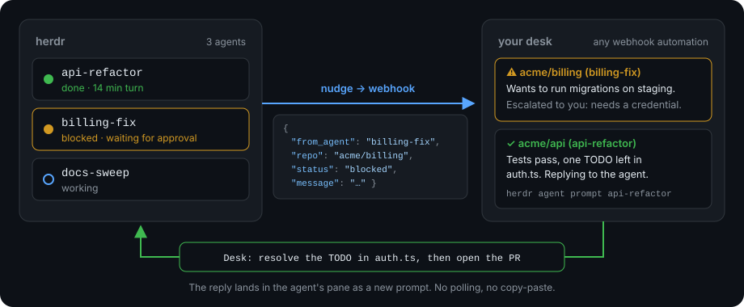
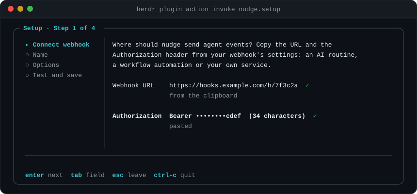

<p align="center">
  
</p>

<h1 align="center">nudge</h1>

<p align="center">
  <b>Your coding agents tell your desk when they're done or stuck.<br>The desk answers right in their pane.</b>
</p>

<p align="center">
  <a href="https://github.com/weskor/nudge/actions/workflows/ci.yml"></a>
  <a href="https://github.com/weskor/nudge/releases/latest"></a>
  
  
  <a href="LICENSE"></a>
</p>

nudge is a [herdr](https://herdr.dev) plugin. When an agent finishes a long turn or gets blocked, it sends a small JSON event to your **desk**: anything that accepts a webhook, such as an AI assistant routine, a workflow automation or your own service. The desk decides what to do. It can answer the agent by running `herdr agent prompt <agent> "..."`, which types the reply into the agent's pane, or escalate to you when a decision is yours.

## Why

- **Stop babysitting panes.** With several agents running, the slow part is noticing that one is done or waiting for approval. nudge notices for you.
- **Let a desk handle the routine.** The desk answers the questions it can (conventions, next steps, "which branch?") and escalates the rest, like credentials or production changes.
- **Answers land where the work is.** Replies arrive in the agent's pane as a new prompt. No copy-paste, no polling.
- **Careful by default.** Automatic notifications are off until you turn them on, skip the pane you're looking at, are rate-limited, and redact anything that looks like a secret.

## Requirements

- herdr 0.9 or later on Linux or macOS (x64 or arm64).
- A desk that accepts an HTTP POST with an `Authorization` header. To reply to agents, the desk needs to run `herdr agent prompt` on the machine where herdr runs.

## Install

```sh
herdr plugin install weskor/nudge
```

The install step downloads the prebuilt `nudge` binary for your platform and checks it against the release checksum, so there's nothing else to install. On other platforms it builds from source if [Bun](https://bun.sh) is installed.

## Quick start

**1. Connect your desk.** Open setup inside herdr:

```sh
herdr plugin action invoke weskor.nudge.setup
```

Copy the webhook URL and press Enter, then do the same for the Authorization header. nudge reads them from the clipboard, never shows the header, and tests the webhook before it saves anything. At the end, setup offers to turn on auto-notify and to install the `nudge` command into `~/.local/bin`.

<p align="center">
  
</p>

**2. Tell your desk what to do with events.** Paste [docs/desk-instructions.md](docs/desk-instructions.md) into its instructions. The template covers when to reply, when to escalate to you, and how to avoid reply loops.

**3. Check it.**

```sh
nudge doctor          # config, plugin, auto-notify, command, clipboard
nudge test            # send a test ping to your desk
```

That's it. Agents in herdr are now covered; they don't need any instructions.

## How it works

### Automatic notifications

The plugin listens to herdr's agent status changes. It notifies your default desk when all of these hold:

| Rule | Why |
| --- | --- |
| The agent is `blocked`, or `done` after a turn of at least 2 minutes | A quick reply isn't worth a desk run |
| You aren't looking at the pane | You already know |
| The agent didn't send its own `nudge notify` during the turn | Its own message says more than terminal output |
| No automatic notification for that pane in the last 5 minutes | Rate limit, and a brake on reply loops |
| Auto-notify is on | Off until you turn it on |

The event carries the last 40 lines of the pane, with credentials replaced by `[REDACTED]`. Every decision, including skipped events and why, is in `herdr plugin log list --plugin weskor.nudge`, and `nudge doctor` shows the most recent ones.

### Notifications written by the agent

Agents (or you) can send their own message, which gives the desk more to go on:

```sh
nudge notify "Finished the auth refactor; PR #42 is ready for review."
nudge notify --status blocked "Need the staging DB password to run migrations."
nudge notify --status question "Use the v2 or v3 pricing API for the demo?"
```

To have agents do this on their own, add a few lines to their instructions:

<details>
<summary>AGENTS.md snippet</summary>

```markdown
## Desk (nudge)

When you finish a task, or need a decision, tell the desk:

    nudge notify --status done "<what you did; branch/PR; anything to check>"
    nudge notify --status blocked "<exactly what you need and why>"
    nudge notify --status question "<the decision you need, with the options>"

- Make the message self-contained: the desk sees only it plus your repo, branch and cwd.
- Don't poll or wait for an answer. A reply arrives later as a new prompt starting with "Desk:".
- Don't notify just to acknowledge a desk reply.
- Never put secrets in a notification.
```

</details>

nudge is also an MCP server, for agents that prefer tools over shell commands: `claude mcp add nudge -- nudge mcp` adds `notify_desk` and `list_desks`.

### The event

POSTed to your desk with its `Authorization` header and `Content-Type: application/json`:

```json
{
  "from_agent": "api-refactor",
  "cwd": "/home/me/src/api",
  "repo": "acme/api",
  "branch": "auth-refactor",
  "status": "blocked",
  "message": "Need the staging DB password to run migrations.",
  "reply_hint": "reply with: herdr agent prompt api-refactor \"...\""
}
```

| Field | Value |
| --- | --- |
| `from_agent` | The herdr agent to reply to: its name, or its pane id if unnamed. `null` when sent from outside an agent pane |
| `repo` | `owner/name` from the `origin` remote, else the directory name; `null` outside git |
| `branch` | The current branch; `null` when detached or outside git |
| `status` | `done`, `blocked`, `question`, or `test` |
| `message` | The agent's text; for automatic events, a note saying so plus the pane's last lines |

## herdr actions

| Action | What it does |
| --- | --- |
| `weskor.nudge.setup` | Open setup in an overlay |
| `weskor.nudge.status` | Open `nudge doctor` in an overlay |
| `weskor.nudge.ask-desk` | Send the focused pane to the desk now, skipping the rules above |
| `weskor.nudge.toggle` | Turn auto-notify on or off (also `.enable`, `.disable`) |

Bind them in `~/.config/herdr/config.toml`, then run `herdr server reload-config`:

```toml
[[keys.command]]
key = "prefix+n"
type = "plugin_action"
command = "weskor.nudge.ask-desk"
description = "nudge: send this pane to the desk"
```

## Privacy and safety

- **What leaves your machine:** only the event above, and only to the webhook you configured. nudge has no server of its own and collects no telemetry.
- **Terminal output** is sent only by automatic notifications and `ask-desk`, after redaction. Redaction covers Authorization/Bearer values, `*TOKEN*`, `*SECRET*`, `*PASSWORD*` and `*API_KEY*` assignments, OpenAI, GitHub, Slack, AWS and Google key formats, JWTs, private-key blocks and long random strings. It is a best-effort filter, not a guarantee, so leave auto-notify off for panes that print sensitive data.
- **The Authorization header** is stored in `~/.config/nudge/config.toml` with mode 600, is never printed, and never appears in error messages.
- **Your desk can type into panes.** Give it the [instructions template](docs/desk-instructions.md), which has it treat event content as data, reply only to the agent that sent the event, and escalate credentials, deploys and other irreversible actions to you.

## Configuration

`nudge setup` writes the config for you; [config.example.toml](config.example.toml) documents the format. To add another desk, run `nudge setup --desk research`. `--default` makes it the desk the plugin uses.

| Path | Holds |
| --- | --- |
| `~/.config/nudge/config.toml` | Desks: webhook URL, Authorization header, optional description |
| `~/.local/state/nudge/state.json` | The auto-notify toggle and per-pane timestamps |
| `~/.local/bin/nudge` | Optional link to the plugin's `nudge` command; kept current across plugin updates |

| Environment variable | Effect |
| --- | --- |
| `NUDGE_CONFIG` | Use another config file |
| `NUDGE_STATE_DIR` | Use another state directory |
| `NUDGE_AGENT` | The agent name to send as `from_agent` |
| `NUDGE_BUN` | Path to Bun, when running from source |
| `NO_COLOR` | Plain output |

<details>
<summary>Command reference</summary>

```text
nudge setup  [--desk NAME] [--url URL] [--authorization VALUE] [--description TEXT] [--default] [--no-test]
nudge notify [--desk NAME] [--status done|blocked|question] [--agent NAME] <message...|->
nudge test   [--desk NAME] [--agent NAME]
nudge doctor [--ping]
nudge list   [--json]
nudge mcp
```

- `notify -` reads the message from stdin.
- Without a terminal, `setup` takes the URL and header from flags or stdin, one per line: `printf '%s\n%s\n' "$URL" "Bearer $TOKEN" | nudge setup`. It still tests before saving; `--no-test` skips that.
- Exit codes: 0 ok, 1 error, 2 usage.

</details>

## Troubleshooting

Start with `nudge doctor`, or `herdr plugin action invoke weskor.nudge.status` to see the same report in herdr. It checks each piece and says how to fix what's broken.

| Symptom | Fix |
| --- | --- |
| Setup says the webhook rejected the Authorization header | Copy the header again. It's usually `Bearer <token>`; a pasted `Authorization:` prefix is fine |
| No notification after an agent finished | `herdr plugin log list --plugin weskor.nudge` shows why it was skipped: a short turn, you were watching, cooldown, or auto-notify off |
| `from_agent` is `null` | The event wasn't sent from an agent's pane, so pass `--agent NAME` |
| `nudge: command not found` | Run `herdr plugin action invoke weskor.nudge.setup` and accept the command install, or add `~/.local/bin` to your `PATH` |

## Limitations

- Linux and macOS only; there's no Windows build yet.
- Automatic events contain terminal output, not a summary; for richer messages, have agents use `nudge notify`.
- Replies need a desk that can reach the machine where herdr runs.

## Contributing

Bug reports and pull requests are welcome. See [CONTRIBUTING.md](CONTRIBUTING.md) to get a development setup running.

## License

[MIT](LICENSE)
