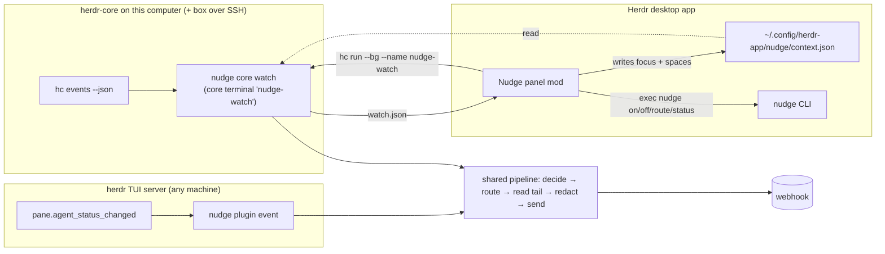

# nudge for the Herdr desktop app: a native panel and a herdr-core backend

Status: **design, not built.** Nothing here is implemented, installed or released.

## In short

The Herdr desktop app runs its agents on **herdr-core** (`hc`), not on the herdr TUI server that nudge talks to today. The two don't share agents, and the desktop app doesn't load TUI plugins, so nudge currently sees nothing that runs in the desktop app.

This design adds four things and changes no existing behavior for TUI users:

1. **A herdr-core backend:** a long-running `nudge core watch` that follows `hc events --json`. It feeds core agents through the **same** rules, redaction, routing and webhook code as the TUI plugin.
2. **Webhook routes:** a new `[[route]]` table in `config.toml`. A route sends one pane's or one workspace's notifications to a webhook other than the default. The most specific route wins: pane, then workspace, then the default webhook.
3. **A global on/off switch:** `nudge on` / `nudge off`. When off, nothing leaves the machine, whichever backend or command tried to send.
4. **A native panel mod for the desktop app** (`mods/nudge/`). It holds the switch, shows each agent and where its notifications go, lets you change that, and starts the watcher. It never handles secrets and never sends anything itself. Every change goes through the `nudge` CLI.

## In our own words: the problem

Agents run in two places:

- **The Herdr desktop app**, on this computer, using herdr-core. The core may reach other machines over SSH (`box/t7`).
- **The herdr TUI** on servers reached over SSH from anywhere, including a phone or tablet.

nudge only understands the TUI today. The goal is for both to behave the same:

- the same rules for when to notify (blocked; done after a long enough turn; skip the pane you're watching; cooldown; away mode);
- the same redaction of terminal output;
- the same config;
- a control surface inside the desktop app that makes three things obvious and changeable in one click: *is nudge on*, *where does each agent's notification go*, and *what did nudge just send*.

Routing matters because some work belongs elsewhere: a client's workspace should go to that client's automation, and a noisy experiment to a quiet one.

Two facts shape the design:

- **What the desktop app shows:** it shows only core agents, and only agents that report their status with OSC 7501. It never shows TUI workspaces.
- **When anything can watch:** a desktop mod runs only while the app window is open. herdr-core keeps agents running after the window closes.

## What you will and won't see

| Where the agent runs | Shows in the desktop app and the Nudge panel | Notified by |
|---|---|---|
| A desktop-app pane, on this computer | Yes, if the agent reports OSC 7501 (Claude Code, Codex and pi do, through plugins or natively [unverified per agent]) | `nudge core watch` here |
| A desktop-app pane on a machine added with `hc machine add` (`box/t7`) | Yes, same condition | `nudge core watch` here (default), or one on `box` (see "Remote machines") |
| A herdr TUI pane, on a server you SSH into | **No.** TUI workspaces, panes and agents never appear in the desktop app or in `hc ls` | The TUI plugin on that server, as today |
| A core terminal without herdr labels (`hc run` from a shell) | Not as a pane. The panel lists it under "Other terminals" if it reports a status | `nudge core watch` |
| An agent that doesn't speak OSC 7501 | Shown as a terminal with no status | Nothing automatic. Core never reads the screen; the TUI does. It can still run `nudge notify` itself, and "Send to webhook" works |

What this means in practice:

- **The panel controls this computer's nudge.** That covers the core agents it sees, plus `nudge notify` calls from anything on this computer. The TUI plugin on a server keeps its own `config.toml` and `state.json` on that server. "Shared config" here means one schema and one code path, not synced files (open question 2).
- **The on/off switch is per machine.** Turning nudge off in the panel doesn't silence a TUI server you SSH into. The panel says so next to the switch.
- **The desktop app already alerts you.** It posts its own toast and plays its own sound when an agent needs you or finishes while you aren't looking. nudge's in-app toast for core agents is off by default so you don't get two.

## Usage (caller's view)

These are written first; the types below are derived from them.

### The panel

```
┌ Nudge ──────────────────────────────── ( ● On ) ┐
│ Auto-notify                              [ on ] │
│ I'm away                                 [off ] │
│ Watching  ● 3 agents · this computer, box       │
├ Agents ─────────────────────────────────────────┤
│ ▲ api-refactor    blocked   → client-a (pane) ⋯ │
│ ● docs-site       working   → main            ⋯ │
│ ✓ box/build       done      → ops (workspace) ⋯ │
├ Workspaces ─────────────────────────────────────┤
│ client-a                    → client-a        ⋯ │
│ nudge                       → main (default)  ⋯ │
├ Recent ─────────────────────────────────────────┤
│ 10:42  api-refactor blocked → client-a   sent   │
│ 10:31  docs-site done       you were watching   │
│ 10:05  box/build done       → ops        sent   │
├─────────────────────────────────────────────────┤
│ Default: main · 3 webhooks          [ Test ] ⋯  │
└─────────────────────────────────────────────────┘
```

- **The big switch** (top right) is `nudge on` / `nudge off`. When off, the header turns muted and reads "Off: nothing is sent from this computer".
- **"Watching"** reflects the watcher. It reads `● … agents` when the watcher runs. When it doesn't, it reads `○ Not watching · [Start]`, and the button starts it. Turning nudge on starts it too.
- **The `⋯` popup on an agent or workspace row** lists the configured webhooks by name. The current one is ticked, followed by "Use workspace / default" and, on agent rows, "Send this pane now". There's no dropdown control in the mod toolkit, so this is a popup overlay, as the shipped `agents` mod does for its sort menu. The arrow shows where notifications go, and why, in parentheses.
- **The footer `⋯`** offers "Add a webhook…", which opens a terminal tab running `nudge setup`; webhook secrets are entered only in nudge's own terminal UI. It also offers "Edit settings…" (`nudge settings` in a tab) and "Open config folder".
- **Keys.** `keys.json` snippets ship with the mod (`mod:nudge` / `global`):
  - `nudge.toggle` turns nudge on or off;
  - `nudge.send` sends the focused pane now;
  - `nudge.route` opens the route popup for the focused pane.

### Commands the panel and scripts use

```sh
nudge on | nudge off                       # global switch, this machine
nudge status --json                        # what the panel draws (no secrets)
nudge route ls [--json]
nudge route set --pane api-refactor --webhook client-a
nudge route set --workspace client-a --webhook client-a [--backend core] [--machine box]
nudge route rm --pane api-refactor
nudge core watch                           # long-running; the panel starts it in a core terminal
nudge core send <address> [--blocked]      # "Send this pane now" for a core terminal
```

### Config, after

```toml
default_webhook = "main"

[[webhook]]
name = "main"
url = "https://hooks.example.com/main"
authorization = "Bearer …"

[[webhook]]
name = "client-a"
url = "https://automation.client-a.example/hook"
authorization = "Bearer …"

# Most specific wins: a pane route, then a workspace route, then default_webhook.
[[route]]
workspace = "client-a"          # TUI workspace label or id, or desktop space name or id
webhook = "client-a"

[[route]]
pane = "api-refactor"           # agent or terminal name, or pane id / core address
webhook = "client-a"
backend = "core"                # optional: "tui" or "core"; without it the route matches both
machine = "box"                 # optional: core machine name; without it, any machine
```

Before this change, a config has no `[[route]]` tables, and it keeps working unchanged.

### Payload, after (additive)

```json
{
  "id": "…", "sent_at": "…", "from_agent": "api-refactor", "cwd": "…", "repo": "…", "branch": "…",
  "status": "blocked", "message": "…",
  "reply_hint": "reply with: hc send api-refactor \"...\"",
  "source": { "backend": "core", "machine": null, "terminal": "t7", "workspace": "client-a" },
  "webhook": "client-a"
}
```

- `source` and `webhook` are new; existing fields keep their meaning.
- The TUI's `reply_hint` stays `herdr agent prompt …`.
- For core, it's `hc send <address> "..."`. `hc send` refuses a blocked agent (exit 9), the same way `herdr agent prompt` answers `agent_blocked` today. The webhook instructions template already escalates auto-detected `blocked` events, so it applies unchanged.

## Shape

### Process model



- **TUI backend: unchanged process model.** herdr runs `nudge plugin event` for each status change. Only the code behind it moves behind the shared pipeline.
- **Core backend: one long-running process, `nudge core watch`**, in a core terminal named `nudge-watch` and labeled `nudge=watch`.
  - It's a core terminal, not a child of the app, so it keeps running when the app window closes or updates; core keeps it alive.
  - It carries no `herdr.space` / `herdr.tab` labels, so it doesn't clutter the app's panes.
  - Core terminal names are unique among live terminals, which makes the watcher single-instance for free. A second `hc run --name nudge-watch` fails, and the panel treats that failure as "already running".
- **Who starts it.** The panel starts the watcher when nudge is on and `hc ls --json --label nudge=watch` shows none. You can also start it by hand (`hc run --bg --name nudge-watch --label nudge=watch -- nudge core watch`), or from a login service for a desktop that's rarely opened (open question 4).
- **Watcher lifecycle:**
  1. **Start:** it runs `hc events --json` as a child process and reads the first line, a snapshot `{seq, terminals}`. It records each terminal's status and `turn` *without notifying*, so a restart doesn't flood the webhook with old `done`s.
  2. **Each `event` line:** `status` gives the new state word, `turn` says a turn ended, and `finished` / `removed` mean the terminal is gone and its state is dropped. Each event is parsed once into a typed `CoreEvent` and turned into the backend-neutral `Transition` that `decide` already understands.
  3. **`missed`:** a fresh snapshot after falling behind. It's reconciled like the start snapshot; no notifications for transitions it can't attribute.
  4. **The stream ends** (core restarted or updated, `hc` missing): retry with backoff (1, 2, 5, 10, 30 s, then every 30 s), logging each attempt. It never exits on its own while nudge is on. When nudge is off it keeps following events but sends nothing, so turn tracking stays correct for when it's turned back on.
- **Watcher status file** (`~/.local/state/nudge/watch.json`). It's written after each change and every 30 s, with no secrets:
  - the pid and when it started;
  - the last event seq and time;
  - `connected` and the machines it sees;
  - each terminal's address, name, status, space id and effective route;
  - the last 20 decisions.

  The panel reads it through `nudge status --json`, which merges in config and state. It redraws when the folder changes (`watchFolder`), so it doesn't poll.

### Remote machines

- **Default: one watcher on this computer.** The local core merges `box/t7` terminals into the same `hc events` stream, so this watcher notifies for every machine the app sees. The catch: when this computer sleeps, nobody watches `box`.
- **`[core] watch = "own"`** on a server makes that server's watcher handle only its own, unprefixed terminals. The laptop's watcher then skips `box/…` terminals when `[core] skip_machines = ["box"]` lists them. Together these cover a server that should be watched while the laptop sleeps, without double notifications. The panel can start the remote watcher with `hc run --bg --on box --name nudge-watch -- nudge core watch` when nudge is installed there.
- **TUI servers are separate.** They run the TUI plugin and don't need this.

### Focus: "skip the pane you're watching"

| Backend | How "you're watching this pane" is known |
|---|---|
| TUI | Unchanged: `herdr agent get <pane>` reports `focused` |
| Core | The panel publishes it, because core has no focus information |

- **What the panel publishes.** It writes `~/.config/herdr-app/nudge/context.json`. The mod may write under `~/.config/herdr-app`, and the watcher reads it from `$HERDR_APP_HOME` or that default. The file has:
  - `terminal`: `focused().terminal`, an address such as `t7` or `box/t7`, or null;
  - `window_active`: from `window().active`;
  - `spaces`: `[{id, name, machine}]`, so routes can match space *names*; core only knows space ids, from the `herdr.space` label;
  - `at`: when it was written.
- **When it's written.** On every render where those values changed, plus a heartbeat every 30 s from a mod timer, plus once in `close()` with `terminal: null` when the app quits.
- **What counts as watched.** A core terminal is "watched" when `context.terminal == address`, `window_active` is true, and the file is under 90 s old. If the file is stale or missing (app closed or crashed), nothing counts as watched. This matches the TUI rule that a failed lookup means "not watched".
- **Away mode is unchanged.** It overrides the focus skip for both backends.
- **Not used:** the app's own `done`→`idle` "seen" bookkeeping. It's app-internal, and the watcher never sees it.

### Routing: pane, then workspace, then default

Every send path resolves its webhook in one place:

```text
resolve(config, source) =
  first [[route]] whose pane matches source      (pane routes, file order)
  else first [[route]] whose workspace matches   (workspace routes, file order)
  else default_webhook (else the only webhook)
```

**What each selector matches,** by name or id like `[scope]` already does:

| Selector | TUI | Core |
|---|---|---|
| `pane` | agent name, or pane id (`w1:p3`) | terminal name, or address (`t7`, `box/t7`) |
| `workspace` | workspace label, or id | desktop space name (from `context.json`), or space id (from the `herdr.space` label) |

Names are preferred because ids change between sessions. The panel writes names when the agent or space has one, and an id only when it doesn't, with a "(by id, ends with the session)" hint.

**Qualifiers:**
- `backend = "tui" | "core"` and `machine = "box"` narrow a route, for when one name exists in both places. Without them, a route matches both backends and any machine.

**Per send path:**
- **Explicit beats routes.** `--webhook` (CLI) and `webhook` (MCP) still win, because the caller named one. Without them, `nudge notify` uses the detected sender's routes.
- **Plugin auto-notify, send-pane, and the core watcher** always resolve through routes.
- **`nudge test`** without `--webhook` pings the default webhook.

**Validation, when the config loads:**
- a route names an existing webhook;
- it has exactly one of `pane` / `workspace`;
- `backend` is `tui` or `core`;
- no two routes have the same selector and qualifiers.

An earlier route in the file never silently shadows an identical later one; that's an error.

**What routing doesn't change:**
- `[scope]` stays an allow-list: whether a sender may notify at all. Routes decide where it goes, and they're checked after scope.
- `send-pane` and `ping` keep ignoring scope.

### The global switch

- **Where it lives.** `state.json` gains `on: bool`. It defaults to true and is written only when false, so existing files read as on.
- **Kept separate from `auto`.** The existing `auto` toggle still means "automatic notifications from terminal output", which is how it's documented.

**What off means:** no webhook request leaves this machine.
- It's checked in **one** function, `webhook::deliver`, which every send path already reaches through `post_to_webhook`. A new send path can't forget it.
- **Auto-notify and the watcher** decide as usual, log `skipped (nudge is off)`, and keep their turn tracking.
- **`nudge notify` and MCP** return success with `"sent": false, "reason": "nudge is off"` and exit 0, so agents don't retry or loop on an error (open question 1). The CLI prints `nudge is off; nothing sent`.
- **`nudge test`** fails with "nudge is off; turn it on with nudge on", because testing while off is a mistake worth flagging.
- **The TUI** gets `nudge.on` / `nudge.off` / `nudge.switch` actions, next to the existing auto and away actions.

### Backend abstraction (Rust)

The shared pipeline knows nothing about herdr's TUI or core:

- **What a backend provides:** events, as `Transition`s; agent facts, as `AgentRef`; a terminal tail; and a reply hint.
- **What the pipeline owns:** rules (`decide`), routing, redaction, the message, the payload and delivery.
- **State keys are namespaced** so the backends can't collide.

```rust
// src/source/mod.rs: what a notification comes from (facade)
/// Which herdr world an agent lives in.
#[derive(Clone, Copy, Debug, PartialEq, Eq, Serialize)]
#[serde(rename_all = "lowercase")]
pub(crate) enum Backend { Tui, Core }

/// An agent as the pipeline sees it. Built once per event at the backend's boundary.
#[derive(Clone, Debug, PartialEq, Eq)]
pub(crate) struct AgentRef {
    pub(crate) backend: Backend,
    /// Core machine (`box`), None for this computer and for the TUI.
    pub(crate) machine: Option<String>,
    /// TUI pane id (`w1:p3`) or core address (`t7`, `box/t7`).
    pub(crate) pane: String,
    /// Agent name (TUI) or terminal name (core), if any.
    pub(crate) name: Option<String>,
    pub(crate) workspace: Option<WorkspaceRef>,
    pub(crate) cwd: Option<String>,
}

#[derive(Clone, Debug, PartialEq, Eq)]
pub(crate) struct WorkspaceRef { pub(crate) id: String, pub(crate) name: Option<String> }

impl AgentRef {
    /// Key in state.json: `tui:w1:p3`, `core:t7`, `core:box/t7`.
    pub(crate) fn state_key(&self) -> String { todo!() }
    /// The reply target the webhook should use: the name if it's shell-safe, else the pane/address.
    pub(crate) fn target(&self) -> &str { todo!() }
}

/// A status change both backends reduce to. `decide` consumes this instead of (pane_id, HerdrStatus).
#[derive(Clone, Copy, Debug, PartialEq, Eq)]
pub(crate) enum AgentStatus { Idle, Working, Done, Blocked, Error, Unknown }

#[derive(Clone, Debug, PartialEq, Eq)]
pub(crate) struct Transition {
    pub(crate) agent: AgentRef,
    pub(crate) status: AgentStatus,
    /// Whether the person is looking at this pane right now (TUI: herdr; core: context.json).
    pub(crate) watched: bool,
    pub(crate) at_ms: i64,
}

/// What a backend can do for the pipeline once a transition settles. Two implementations: `TuiSource`
/// (wraps today's `src/herdr/`) and `CoreSource` (wraps `hc`).
pub(crate) trait AgentSource {
    /// The last lines of the pane's terminal, raw (ANSI included); redaction happens in the pipeline.
    fn tail(&self, agent: &AgentRef, lines: usize) -> Option<String>;
    /// "reply with: herdr agent prompt …" or "reply with: hc send …".
    fn reply_hint(&self, agent: &AgentRef) -> String;
    /// Show a short in-app message, if this backend has a way (TUI toast; core: none, returns false).
    fn toast(&self, text: &str) -> bool;
}
```

```rust
// src/pipeline/: shared by both backends
/// The one place a settled transition becomes a webhook request.
pub(crate) fn handle(transition: Transition, source: &dyn AgentSource, ctx: &Context<'_>) -> Result<Outcome>;
//   1. decide (rules; mutates state under its lock; Error is treated as Blocked with its own lead line)
//   2. in_scope (unchanged, now on AgentRef)
//   3. resolve route (config::routes::resolve)
//   4. tail -> auto_message (redact first, then cut) -> Notification { source, webhook, ... }
//   5. webhook::deliver (checks the global switch, posts, records the decision for status.json)
//   6. roll back the reserved cooldown when nothing was sent (as today)

// src/config/routes.rs
pub(crate) struct Route { pub(crate) selector: Selector, pub(crate) webhook: String,
                          pub(crate) backend: Option<Backend>, pub(crate) machine: Option<String> }
pub(crate) enum Selector { Pane(String), Workspace(String) }
/// Pane routes first, then workspace routes, each in file order; None = use the default.
pub(crate) fn resolve<'a>(routes: &'a [Route], agent: &AgentRef) -> Option<&'a Route>;

// src/core/: the herdr-core backend
pub(crate) fn watch(env: &Env) -> Result<u8>;                           // `nudge core watch`
enum CoreLine { Snapshot(Snapshot), Event(CoreEvent), Heartbeat, Missed(Snapshot), Other }
fn parse_line(line: &str) -> CoreLine;                                   // the parsing boundary
struct CoreSource<'a> { env: &'a Env, run: &'a dyn Run }                // tail = hc read, hint = hc send
struct AppContext { terminal: Option<String>, window_active: bool, spaces: Vec<SpaceRef>, at_ms: i64 }
fn read_app_context(env: &Env) -> Option<AppContext>;                    // ~/.config/herdr-app/nudge/context.json
```

**Module map:**
- **New:**
  - `src/source/` holds `AgentRef`, `Backend`, `AgentStatus`, `Transition` and the `AgentSource` trait;
  - `src/pipeline/` holds `handle` and its steps;
  - `src/core/` holds the event parser, `CoreSource`, the app context, the watcher loop, `watch.json`, and `nudge core send`;
  - `src/config/routes.rs`, plus `src/config/parse/routes.rs`.
- **Changed:**
  - `src/plugin/status.rs` builds a `Transition` and calls `pipeline::handle`;
  - `src/plugin/send_pane.rs` resolves routes;
  - `src/auto/rules.rs` takes `&Transition` and the state key;
  - `src/webhook/` gains `deliver` (the switch check) and the `source` and `webhook` fields;
  - `src/state.rs` gains `on` and prefixed keys;
  - `src/cli/` gains `on`, `off`, `status`, `route` and `core`.
- **Each file:** ≤300 lines, functions ≤50, tests in `tests.rs` beside them, as AGENTS.md requires.

### Config schema changes and migration

- **New: `[[route]]`.** It's added to the model, the parser (`parse/routes.rs`), the serializer and `config.example.toml` **together**. Every nudge writer rebuilds the file from the model, so a missing piece would drop routes on the next save.
- **New: `[core]`,** with `watch = "connected" | "own"` (default `connected`) and `skip_machines = [...]` (default empty). It's only written when it differs from the defaults.
- **No renames, so no migration of `config.toml`.** An existing file is valid and means exactly what it meant.
- **Older nudge versions reading a new file.** An older version ignores the unknown top-level `route` and `core` keys, and **drops them if it saves** (settings, setup, the scope actions). This only bites if one machine runs mixed versions. The changelog says so.
- **`state.json` migration.** Pane keys without a prefix (`w1:p3`) are read as `tui:w1:p3` and written back prefixed. This happens on the next `update_state`, under the existing lock. `on` is absent from old files and means on.

### The mod

**Files** (in this repo, under `herdr-app/mods/nudge/`; installing it is a copy into `~/.config/herdr-app/mods/`, see open question 8):

| File | Holds |
|---|---|
| `mod.json` | `{"place": "right", "size": 320, "title": "Nudge"}` |
| `main.js` | The `View`: state, `render`, actions |
| `rows.js` | Pure helpers: agents and spaces into rows; the label for a route and its reason |
| `popup.js` | The route popup, an overlay of the same mod with `props().routeFor` |
| `keys.json` | The snippet for `nudge.toggle`, `nudge.send` and `nudge.route` |
| `RECIPE.md` | The herdr.dev/mods recipe ("What you see", "How it behaves" per agent status, "Watch out": it runs programs and reads files) |

**Data it reads:**
- live data from the app: `agents()`, `terminals()`, `panes()`, `spaces()`, `focused()`, `window()`;
- `nudge status --json`, read with `exec`, **once on load and whenever `watchFolder(~/.local/state/nudge)` reports a change**.

**What it writes:**
- `context.json`, the only file it writes;
- every change, through `exec("nudge", [...])`: `on`, `off`, `auto`, `away`, `route set/rm`, `test`, `core send`;
- the watcher start, with `hc([...])`.

It never reads `config.toml`, and never sees a URL or secret. `nudge status --json` lists webhooks by name and host only, like `nudge settings` does.

**The switch is the mod's first job, and it's optimistic.** Flipping it updates the row at once. If `nudge on` / `nudge off` fails, the row flips back and a toast says why.

**Toasts:**
- on a failed send (`notify({level: "error", title: "nudge couldn't reach client-a", action: {name: "nudge.open"}})`);
- on "Send this pane now".

There are none for routine sends; the app already alerts you for blocked and done.

```js
// main.js (shape only)
import { View, div } from "gpui-kit";
import { Switch, Button } from "gpui-base";
import { agents, spaces, focused, window as appWindow, exec, hc, notify, openOverlay,
         nextCommand, watchFolder, home } from "herdr";
import { agentRows, spaceRows } from "./rows.js";

export default class Nudge extends View {
  init(props, cx) {
    this.status = null;          // parsed `nudge status --json`
    this.lastContext = "";       // last context.json text written
    cx.spawn(async (cx) => { await this.refresh(cx); for (;;) { await watchFolder(stateDir()); await this.refresh(cx); } });
    cx.spawn(async (cx) => { for (;;) { const c = await nextCommand(); await this.command(c, cx); } });
    cx.spawn(async (cx) => { for (;;) { await cx.timer(30000); this.writeContext(true); } }); // heartbeat
  }
  render(cx) {
    this.writeContext(false);    // focus/spaces changed? write context.json (no-op if unchanged)
    // header: title + Switch(status.on) ; auto/away rows ; watcher line
    // agentRows(agents(), status) ; spaceRows(spaces(), status) ; recent ; footer
  }
  async close(cx) { await this.writeContext(true, { terminal: null }); } // app quits: nothing is watched
}
```

## Synthesis decision

The architect process normally runs two independent designers and grafts the stronger parts of one into the other. Both runners failed on a model rate limit, so this design was written by one author against the same grounding. The "Alternatives considered" below are the structurally different shapes it was screened against. Running the arena again before implementation is cheap; see "Next step".

## Tradeoffs accepted

- **A long-running process for the core backend,** in exchange for notifications that don't depend on the app window being open, and for keeping rules, redaction and routing in Rust only.
- **Focus for core comes from the app through a file,** so it's only as fresh as the app's last write (90 s at most). In exchange, core needs no focus support, and a closed app means "not watched", which is the safe direction: you get notified.
- **Two switches (`on` and `auto`),** in exchange for not changing what `auto` already means for TUI users and their docs. The panel shows `on` as the big switch, and `auto` as a row under it.
- **`nudge notify` exits 0 when nudge is off,** in exchange for agents never retrying or looping on an error they can't fix. The output says nothing was sent.
- **Routes match by name or id,** like `[scope]`. In exchange for readable configs, renaming a workspace or terminal breaks its route. The panel shows the reason next to every route, so a broken one is visible.
- **One watcher per machine by default,** watching connected machines too. In exchange for zero setup, remote agents go unwatched while the laptop sleeps. `[core] watch = "own"` fixes that per server.
- **`Error` (an OSC 7501 state) is notified as `blocked`,** with its own lead line ("Agent reported an error"), in exchange for not adding a payload status that existing automations don't know (open question 3).

## Alternatives considered

- **Rules in the mod (JavaScript).** The mod diffs `agents()` in `render`, applies the rules, reads the tail with `hc read`, and POSTs with `fetch`.
  - For: the smallest moving parts, and the mod has focus info natively.
  - Lost because:
    - it duplicates `decide`, redaction and routing in a second language;
    - it puts webhook secrets in JS;
    - nothing is watched when the app window is closed.
  - It fails requirement 3 ("shared rules and redaction") outright.
- **The mod forwards transitions to `nudge` per event** (`exec("nudge", ["core", "settled", addr, status])`), with Rust deciding.
  - For: the rules stay shared, and focus comes in directly with each call.
  - Lost because nothing is watched while the app is closed, an `exec` runs per status change, and a burst of changes races the 30 s exec limit.
  - It's kept as a fallback if a long-running watcher turns out not to be viable (open question 4).
- **A system service** (systemd user unit / launchd agent) instead of a core terminal.
  - For: it survives reboots without the app.
  - Lost for v1: it needs two platform-specific installers. A core terminal already outlives the app and is visible in `hc ls`.
  - It remains an option for setups where the app is rarely opened.
- **Routes folded into `[scope]`** (one table that says who may notify and where to).
  - For: one concept.
  - Lost because it changes the meaning of every existing `[scope]` and of the scope actions. Allow-or-refuse and where-to are separate questions, and both are easier to explain separately.
- **One switch only, by redefining `auto` as the global switch.**
  - Lost because it silently changes what `nudge notify` does for agents on TUI servers after an upgrade, and today's docs say `auto` is about automatic notifications only.

## Test plan

**Unit tests** (in `tests.rs` beside each module, with `FakeRun` / `FakeWebhook` only):

- **Routing.** A precedence table:
  - a pane route beats a workspace route, which beats the default;
  - routes match by name and by id;
  - `backend` and `machine` qualifiers narrow the match;
  - an explicit `--webhook` beats every route;
  - a route that names a missing webhook is a config error;
  - duplicate selectors are an error.
- **Config.** Parse → serialize → parse round-trips with routes and `[core]`. A config without routes is byte-identical after a save. The example config parses.
- **State.** Unprefixed keys read as `tui:`. `on` defaults to true, and the file omits it while true.
- **Global switch.** Every entry point, when off:
  - plugin event, send-pane and the core watcher sent nothing, and logged why;
  - `nudge notify` and MCP report not sent and exit 0;
  - `nudge test` fails.

  Turning nudge back on sends again.
- **Core parsing.** The snapshot line; `status`, `turn`, `finished`, `removed`, `missed` and `heartbeat`; unknown event types and fields ignored; a malformed line skipped with a log line, never a panic; remote addresses `box/t7` split into machine and terminal.
- **Watcher behavior** with a scripted fake event stream:
  - no notification for the snapshot;
  - blocked notifies;
  - done after `min_turn` notifies, a short turn doesn't;
  - cooldown applies;
  - `missed` reconciles without notifying;
  - stream end leads to a retry;
  - a terminal that's removed drops its state.
- **Focus.** Watched only when `context.json` names the address, the window is active and the file is under 90 s old. Away overrides.
- **Payload.** `source` and `webhook` are present. `reply_hint` is per backend, with shell-safe quoting for both.

**Parity harness** (`verify-nudge`):

- **A `fake-hc` next to `fake-herdr`.** It serves `hc events --json` from a scenario script, and `hc ls/read/send/run` from a fixture; it's never the real core.
- **New scenarios:**
  - core blocked and done;
  - focus skip through a seeded `context.json`;
  - a stale context;
  - away;
  - routes pane > workspace > default, for both backends;
  - switch off for every entry point;
  - the watcher's single-instance and reconnect behavior;
  - `nudge route` and `nudge status --json` output (checked for no secrets by the harness's existing secret scan).
- **Existing scenarios must not change,** except for these intended diffs:
  - `state.json` keys gain `tui:`;
  - payloads gain `source` and `webhook`.

  Each slice's PR shows its parity diff.

**The mod:**
- `herdr-app check herdr-app/mods/nudge` in CI, if the `herdr-app` binary can run headless in CI (open question 6); otherwise it's a documented manual step.
- `rows.js` and `popup.js` are pure functions, tested with `bun test` against recorded `agents()` / `spaces()` / `nudge status --json` samples.
- A manual checklist, with `herdr-app shot` screenshots attached to the PR:
  - the switch flips both ways, and a failure reverts it;
  - a route popup sets a route and shows its reason;
  - closing the app clears focus;
  - the watcher-start button works;
  - the app works with nudge not installed (the panel says so and offers nothing else).

Not tested automatically: real OSC 7501 output from specific agents. The fake event stream stands in for it.

## Small PR slices

Each slice goes to `main` on its own with green CI and its parity diff. None of them needs a release; releases follow the repo's release decision.

1. **State keys and the global switch.**
   - `state.json` gets prefixed keys (and their migration) plus `on`.
   - `webhook::deliver` checks the switch.
   - New commands `nudge on|off`; TUI actions `nudge.on/off/switch`; `nudge doctor` reports the switch.
   - Parity diff: the `tui:` key prefix, and the new scenarios.
2. **Routes.**
   - Config model, parser, serializer and example.
   - `config::routes::resolve` is used by plugin auto-notify, send-pane and `nudge notify`.
   - New commands `nudge route ls|set|rm`, and `nudge settings` shows routes read-only.
   - The payload gains `webhook`.
3. **The `source` seam.**
   - New `src/source/` types and `src/pipeline/handle`.
   - The TUI plugin is moved behind `AgentSource`.
   - The payload gains `source`.
   - No behavior change beyond the payload fields.
4. **The core backend.**
   - `src/core/`, with event parsing, `CoreSource`, `nudge core watch` and `nudge core send`, plus `watch.json`.
   - `fake-hc` and the core scenarios.
5. **App context and status.**
   - Reading `context.json` for focus and space names.
   - `nudge status --json`.
   - `[core]` settings.
6. **The panel mod, v1.**
   - `herdr-app/mods/nudge/`, with the switch, the auto/away rows, the watcher line, the agents list with routes and the route popup, recent decisions, and the footer actions.
   - `keys.json` and `RECIPE.md`.
   - The `bun test`s for the pure helpers.
7. **Docs.**
   - README: a "Herdr desktop app" section with "what you'll see", plus install of the mod.
   - `docs/webhook-instructions.md`: `source`, and the `hc send` reply.
   - `config.example.toml`: routes and `[core]`.
   - CONTRIBUTING layout.

## Open questions

1. **Global switch and agent-sent notifications.** When nudge is off, should `nudge notify` / MCP report "not sent" and exit 0 (as designed), or fail so the agent tells you? The design picks exit 0 to avoid agent retry loops.
2. **Config across machines.** Is per-machine config fine, with the TUI server keeping its own `config.toml`? Or should the panel be able to edit a TUI server's config? That would mean `exec("nudge", [...], {on: machine})` for machines added to core; servers you reach only over plain SSH would be out of reach.
3. **OSC 7501 `error`.** Notify it as `blocked` with an "Agent reported an error" lead, as designed? Or add `"status": "error"` to the payload, a contract change for existing automations?
4. **Starting the watcher.** Is "the panel starts it in a core terminal" enough? Or should v1 also ship a login service, so core agents are watched after a reboot before the app is opened?
5. **Remote machines' default.** Should the laptop watch connected machines by default (as designed), or should it be "own terminals only", requiring a watcher on each server? The second avoids gaps while the laptop sleeps, but needs nudge installed on every server.
6. **Mod CI.** Can `herdr-app check` run in CI (Linux, headless)? If not, mod validation stays manual.
7. **Sender detection for `nudge notify` inside a core terminal.** Does core set an environment variable that names the current terminal? Its "parent defaults to the terminal it is started from" suggests it does [unverified]. If it doesn't, nudge falls back to matching the cwd against `hc ls --json`, as it does for herdr today.
8. **Where the mod lives and how it's installed.** In this repo under `herdr-app/mods/nudge/`, and published to herdr.dev/mods as a `herdr-mod` repo (needs its own repo with `mods/<name>/`, `RECIPE.md` and `preview.png`)? Or install-by-copy only?
9. **Default webhook naming in the panel.** Should it allow choosing a new default webhook (`default_webhook`), or leave that to `nudge settings`?

## Risks

- **herdr-core's protocol is a preview** ("protocol generation 1, version 0.x", additive-only). The event parser ignores unknown fields and types, and the watcher logs and skips any line it can't parse. A breaking change would show up as "Watching: not connected" in the panel, not as wrong notifications.
- **Mod APIs may move.** The app is new, and `herdr.d.ts` is generated by each release. The mod pins nothing it doesn't need, and keeps logic in two pure helper files.
- **Which agents emit OSC 7501.** Core never reads the screen, so an agent that doesn't report status gets no automatic notifications in the desktop app, even though the TUI would notify for the same agent. The README states this plainly.

## Next step

Answer the open questions, especially 1, 3 and 4. Optionally re-run the two-designer arena on this document. Then build slice 1: state keys and the global switch.
