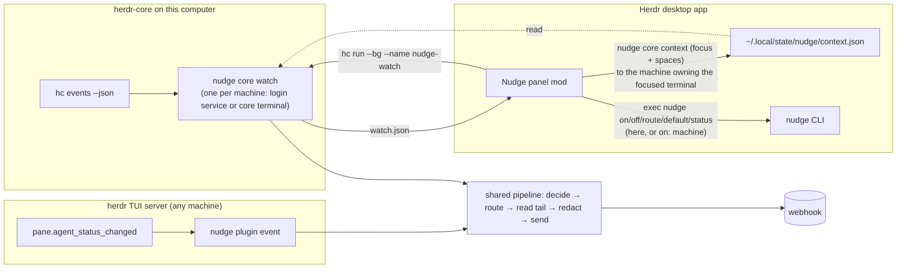

# nudge for the Herdr desktop app: a native panel and a herdr-core backend

Status: **design approved 2026-11-02, being built in slices.** The decisions on the original open questions are recorded in "Decisions" below and folded into every section.

## In short

The Herdr desktop app runs its agents on **herdr-core** (`hc`), not on the herdr TUI server that nudge talks to today. The two don't share agents, and the desktop app doesn't load TUI plugins, so nudge currently sees nothing that runs in the desktop app.

This design adds four things and changes no existing behavior for TUI users:

1. **A herdr-core backend:** a long-running `nudge core watch` that follows `hc events --json`. It feeds core agents through the **same** rules, redaction, routing and webhook code as the TUI plugin. Each machine runs its own watcher for its own terminals. It's started by a login service (systemd user unit on Linux, launchd agent on macOS) and by the panel.
2. **Webhook routes:** a new `[[route]]` table in `config.toml`. A route sends one pane's or one workspace's notifications to a webhook other than the default. The most specific route wins: pane, then workspace, then the default webhook.
3. **A global on/off switch:** `nudge on` / `nudge off`. When off, nothing leaves the machine, whichever backend or command tried to send. An agent that runs `nudge notify` while it's off gets an error ("nudge is off"), so it tells you instead of believing it was heard.
4. **A native panel mod for the desktop app** (`mods/nudge/`). It holds the switch, shows each agent and where its notifications go, lets you change that, picks the default webhook, starts the watcher, and does the same for each connected machine. It never handles secrets and never sends anything itself. Every change goes through the `nudge` CLI, on this computer or on a connected machine. The mod lives in this repo and is also published on herdr.dev/mods.

## Decisions (2026-11-02)

| # | Question | Decision |
|---|---|---|
| 1 | `nudge notify` / MCP while nudge is off | **Fail**: non-zero exit (1) and the error `nudge is off: nothing was sent. Turn it on with nudge on` (MCP: a tool error with the same text), so the agent tells you |
| 2 | Config across machines | Per-machine files stay. The panel edits a **connected** machine's config and switch by running `nudge` there (`exec(..., {on: machine})`). TUI servers reached only over plain SSH are out of reach, and the panel says so |
| 3 | OSC 7501 `error` | Sent as `blocked`, with the lead "Agent reported an error" |
| 4 | Starting the watcher | v1 ships a login service (systemd user unit on Linux, launchd agent on macOS) **and** the panel's start. Still single-instance per machine |
| 5 | Remote machines | Each server runs its own watcher for its own terminals. The local watcher skips connected machines' terminals by default |
| 6 | Mod CI | `bun test` for the mod's pure helpers in CI; `herdr-app check` as a required manual step in the mod's PRs, run by `scripts/check-mod.sh` when `herdr-app` is installed (see "Test plan" for why) |
| 7 | Sender detection inside a core terminal | herdr-core sets `HC_TERMINAL_ID` (the terminal's address, e.g. `t7`) and `HC_TERMINAL_SOCKET` in every terminal it starts (`crates/herdr-core/src/api/run.rs`). nudge uses `HC_TERMINAL_ID`, like `HERDR_PANE_ID` for the TUI |
| 8 | Where the mod lives | In this repo (`herdr-app/mods/nudge/`) **and** published on herdr.dev/mods from a separate `herdr-mod` repo. Creating that repo and publishing wait for Wes's OK |
| 9 | Default webhook from the panel | Yes: the panel can change `default_webhook` |

## In our own words: the problem

Agents run in two places:

- **The Herdr desktop app**, on this computer, using herdr-core. The core may reach other machines over SSH (`box/t7`).
- **The herdr TUI** on servers reached over SSH from anywhere, including a phone or tablet.

nudge only understands the TUI today. The goal is for both to behave the same:

- the same rules for when to notify (blocked; done after a long enough turn; skip the pane you're watching; cooldown; away mode);
- the same redaction of terminal output;
- the same config;
- a control surface inside the desktop app that makes three things obvious and changeable in one click: *is nudge on*, *where does each agent's notification go*, and *what did nudge just send*.

Routing matters because some work belongs elsewhere: a client's workspace should go to that client's automation, and a noisy experiment to a quiet one.

Two facts shape the design:

- **What the desktop app shows:** it shows only core agents, and only agents that report their status with OSC 7501. It never shows TUI workspaces.
- **When anything can watch:** a desktop mod runs only while the app window is open. herdr-core keeps agents running after the window closes.

## What you will and won't see

| Where the agent runs | Shows in the desktop app and the Nudge panel | Notified by |
|---|---|---|
| A desktop-app pane, on this computer | Yes, if the agent reports OSC 7501 (Claude Code, Codex and pi do, through plugins or natively [unverified per agent]) | `nudge core watch` here |
| A desktop-app pane on a machine added with `hc machine add` (`box/t7`) | Yes, same condition | The watcher on `box` (each machine watches its own terminals). If `box` has no watcher, nobody notifies, and the panel shows "box: not watching · [Start]" |
| A herdr TUI pane, on a server you SSH into | **No.** TUI workspaces, panes and agents never appear in the desktop app or in `hc ls` | The TUI plugin on that server, as today |
| A core terminal without herdr labels (`hc run` from a shell) | Not as a pane. The panel lists it under "Other terminals" if it reports a status | `nudge core watch` |
| An agent that doesn't speak OSC 7501 | Shown as a terminal with no status | Nothing automatic. Core never reads the screen; the TUI does. It can still run `nudge notify` itself, and "Send to webhook" works |

What this means in practice:

- **The panel controls this computer's nudge, and each connected machine's.** Connected means added with `hc machine add`; the panel runs `nudge` there through core. Each machine keeps its own `config.toml` and `state.json`; "shared config" means one schema and one code path, not synced files.
- **TUI servers you reach only over plain SSH are out of the panel's reach.** That includes the servers you use from a phone or tablet, unless they're also added with `hc machine add`. They keep their own settings; change them there with `nudge on|off`, `nudge settings` or the `nudge.*` herdr actions. The panel's machine list ends with a note saying exactly this.
- **The on/off switch is per machine.** The panel shows one switch per machine, and turning this computer off doesn't silence a server.
- **The desktop app already alerts you.** It posts its own toast and plays its own sound when an agent needs you or finishes while you aren't looking. nudge's in-app toast for core agents is off by default so you don't get two.

## Usage (caller's view)

These are written first; the types below are derived from them.

### The panel

```
┌ Nudge ────────────────────────────────────────────────┐
│ [ This computer ▾ ]                          ( ● On ) │
│ Auto-notify                                    [ on ] │
│ I'm away                                       [off ] │
│ Watching  ● 2 agents · service running                │
├ Agents ───────────────────────────────────────────────┤
│ ▲ api-refactor    blocked   → client-a (pane)       ⋯ │
│ ● docs-site       working   → main                  ⋯ │
├ Workspaces ───────────────────────────────────────────┤
│ client-a                    → client-a              ⋯ │
│ nudge                       → main (default)        ⋯ │
├ Recent ───────────────────────────────────────────────┤
│ 10:42  api-refactor blocked → client-a   sent         │
│ 10:31  docs-site done       you were watching         │
├───────────────────────────────────────────────────────┤
│ Default webhook: main ⋯ · 3 webhooks        [ Test ]  │
└───────────────────────────────────────────────────────┘
```

The machine popup (`[ This computer ▾ ]`):

```
┌──────────────────────────────────────────┐
│ ✓ This computer        ● on · watching   │
│   box                  ● on · watching   │
│   gpu-vm               ○ nudge not found │
│ ──────────────────────────────────────── │
│ Servers you reach only over SSH (herdr   │
│ TUI) aren't listed. Change them there:   │
│ nudge on|off, or the nudge.* actions.    │
└──────────────────────────────────────────┘
```

- **The machine picker** chooses whose nudge the panel shows and edits. Its entries are this computer plus every `machines()` entry the app knows. Choosing `box` makes every read and command below run as `exec("nudge", [...], {on: "box"})`.
  - The agents and workspaces listed are the ones on that machine.
  - A machine where `nudge` isn't installed shows "nudge not found", and nothing else.
- **The big switch** (top right) is `nudge on` / `nudge off` on the picked machine. When off, the header turns muted and reads "Off: nothing is sent from this computer" (or "from box").
- **"Watching"** reflects that machine's watcher: `● … agents · service running` (or `· started here`) when one runs. When none runs, it reads `○ Not watching · [Start]`. The button starts it in a core terminal there; "Install service…" in the footer menu installs the login service.
- **The `⋯` popup on an agent or workspace row** lists the configured webhooks by name. The current one is ticked, followed by "Use workspace / default" and, on agent rows, "Send this pane now". There's no dropdown control in the mod toolkit, so this is a popup overlay, as the shipped `agents` mod does for its sort menu. The arrow shows where notifications go, and why, in parentheses.
- **"Default webhook: main ⋯"** opens the same kind of popup and sets `default_webhook` (`nudge default <name>`).
- **The footer menu** (`⋯` at the end of the default line) offers:
  - "Add a webhook…", which opens a terminal tab running `nudge setup` (on the picked machine); webhook secrets are entered only in nudge's own terminal UI;
  - "Edit settings…" (`nudge settings` in a tab);
  - "Install service…" / "Remove service";
  - "Open config folder" (this computer only).
- **Keys.** `keys.json` snippets ship with the mod (`mod:nudge` / `global`):
  - `nudge.toggle` turns this computer's nudge on or off;
  - `nudge.send` sends the focused pane now;
  - `nudge.route` opens the route popup for the focused pane.

### Commands the panel and scripts use

The panel runs each of these locally, or on a connected machine with `exec(..., {on: machine})`.

```sh
nudge on | nudge off                       # global switch, this machine
nudge status --json                        # what the panel draws (no secrets)
nudge default <webhook>                    # set default_webhook
nudge route ls [--json]
nudge route set --pane api-refactor --webhook client-a
nudge route set --workspace client-a --webhook client-a [--backend core]
nudge route rm --pane api-refactor
nudge core watch                           # long-running; single instance per machine
nudge core service install | remove | status   # login service: systemd user unit / launchd agent
nudge core send <address> [--blocked]      # "Send this pane now" for a core terminal
```

### Config, after

```toml
default_webhook = "main"

[[webhook]]
name = "main"
url = "https://hooks.example.com/main"
authorization = "Bearer …"

[[webhook]]
name = "client-a"
url = "https://automation.client-a.example/hook"
authorization = "Bearer …"

# Most specific wins: a pane route, then a workspace route, then default_webhook.
[[route]]
workspace = "client-a"          # TUI workspace label or id, or desktop space name or id
webhook = "client-a"

[[route]]
pane = "api-refactor"           # agent or terminal name, or pane id / core address
webhook = "client-a"
backend = "core"                # optional: "tui" or "core"; without it the route matches both
```

Before this change, a config has no `[[route]]` tables, and it keeps working unchanged.

### Payload, after (additive)

```json
{
  "id": "…", "sent_at": "…", "from_agent": "api-refactor", "cwd": "…", "repo": "…", "branch": "…",
  "status": "blocked", "message": "…",
  "reply_hint": "reply with: hc send api-refactor \"...\"",
  "source": { "backend": "core", "host": "laptop", "terminal": "t7", "workspace": "client-a" },
  "webhook": "client-a"
}
```

- `source` and `webhook` are new; existing fields keep their meaning. `source.host` is the machine's hostname, so an automation serving several machines knows where to reply.
- The TUI's `reply_hint` stays `herdr agent prompt …`.
- For core, it's `hc send <address> "..."`. `hc send` refuses a blocked agent (exit 9), the same way `herdr agent prompt` answers `agent_blocked` today. The webhook instructions template already escalates auto-detected `blocked` events, so it applies unchanged.

## Shape

### Process model



- **TUI backend: unchanged process model.** herdr runs `nudge plugin event` for each status change. Only the code behind it moves behind the shared pipeline.
- **Core backend: one long-running process per machine, `nudge core watch`.**
  - **Single instance.** On start, the watcher takes an exclusive lock on `~/.local/state/nudge/watch.lock` (an advisory `flock`, released by the kernel when the process dies, so a crash never leaves a stale lock). A second watcher, from the service or the panel, prints "nudge core watch is already running (pid N)" and exits 0.
  - **It keeps running without the app.** Whether the service or the panel started it, it isn't a child of the app, so closing or updating the app window doesn't stop it.
- **Who starts it:**
  - **The login service** (v1). `nudge core service install` writes and enables a per-user service that runs `nudge core watch` at login and restarts it if it fails:
    - Linux: a systemd user unit, `~/.config/systemd/user/nudge-watch.service`, with `ExecStart=<absolute path to nudge> core watch`, `Restart=on-failure`, `RestartSec=10`, and `Environment=PATH=…` captured at install so `hc` is found. Installing runs `systemctl --user daemon-reload` and `systemctl --user enable --now nudge-watch.service`.
    - macOS: a launchd agent, `~/Library/LaunchAgents/dev.nudge.watch.plist`, with `RunAtLoad`, `KeepAlive` on failure and the same PATH. Installing runs `launchctl bootstrap gui/<uid>` on it.
    - `nudge core service remove` disables and deletes it; `status` reports installed, running and the unit path. herdr-core uses the same two mechanisms for its own server.
  - **The panel.** When the picked machine's nudge is on and no watcher holds the lock, "Watching" offers `[Start]`, which runs `hc run --bg --name nudge-watch --label nudge=watch -- nudge core watch` there. That core terminal carries no `herdr.space` / `herdr.tab` labels, so it doesn't clutter the app's panes, and it outlives the app window. "Install service…" in the footer menu runs `nudge core service install` there.
  - **By hand,** with either command.
- **Watcher lifecycle:**
  1. **Start:** it runs `hc events --json` as a child process and reads the first line, a snapshot `{seq, terminals}`. It records each terminal's status and `turn` *without notifying*, so a restart doesn't flood the webhook with old `done`s.
  2. **Each `event` line:** `status` gives the new state word, `turn` says a turn ended, and `finished` / `removed` mean the terminal is gone and its state is dropped. Each event is parsed once into a typed `CoreEvent` and turned into the backend-neutral `Transition` that `decide` already understands.
  3. **`missed`:** a fresh snapshot after falling behind. It's reconciled like the start snapshot; no notifications for transitions it can't attribute.
  4. **The stream ends** (core restarted or updated, not running yet at login, `hc` missing): retry with backoff (1, 2, 5, 10, 30 s, then every 30 s), logging each attempt. It never exits on its own. When nudge is off it keeps following events but sends nothing, so turn tracking stays correct for when it's turned back on.
- **Watcher status file** (`~/.local/state/nudge/watch.json`). It's written after each change and every 30 s, with no secrets:
  - the pid, when it started, and how (service or terminal);
  - the last event seq and time;
  - `connected`;
  - each terminal's address, name, status, space id and effective route;
  - the last 20 decisions.

  The panel reads it through `nudge status --json`, which merges in config and state. For this computer it redraws when the folder changes (`watchFolder`), so it doesn't poll. For a connected machine, `watchFolder` isn't available (it's local-only), so the panel re-reads that machine's status every 10 s, and only while that machine is picked.

### Remote machines

- **Each machine watches its own terminals.** The default is `[core] watch = "own"`: a watcher handles only its core's own, unprefixed terminals (`t7`) and skips connected machines' terminals (`box/t7`). So a server's agents are watched by that server's watcher, which keeps working while the laptop sleeps, and no terminal is ever notified twice.
- **Setting up a server** from the panel (with `box` picked): install nudge there (a terminal tab running nudge's install), set up a webhook ("Add a webhook…"), then "Install service…". On a server, a systemd user service only runs without a login session if lingering is on (`loginctl enable-linger`). nudge doesn't change that itself; `nudge core service install` checks and prints the command when it's off.
- **`[core] watch = "connected"`** is the opt-in for a machine that can't run nudge: the local watcher then also handles connected machines' terminals, with the old catch that nobody watches them while this computer sleeps. The panel shows that machine as "watched from this computer".
- **TUI servers are separate.** They run the TUI plugin and don't need this.

### Focus: "skip the pane you're watching"

| Backend | How "you're watching this pane" is known |
|---|---|
| TUI | Unchanged: `herdr agent get <pane>` reports `focused` |
| Core | The panel publishes it, because core has no focus information |

- **What the panel publishes,** with `nudge core context '<json>'` (an `exec`, so nudge parses and writes it; the mod writes no files itself). nudge stores it in `~/.local/state/nudge/context.json` on that machine. The JSON has:
  - `terminal`: the focused terminal's address **on that machine** (`t7`), or null;
  - `window_active`: from `window().active`;
  - `spaces`: `[{id, name}]` for that machine's spaces, so routes can match space *names*; core only knows space ids, from the `herdr.space` label;
  - `at`: when it was sent.
- **Which machine gets it.** Each machine's watcher only needs to know about its own terminals:
  - when focus moves to `box/t7`, the panel sends `terminal: "t7"` to `box` (`exec(..., {on: "box"})`) and `terminal: null` to the machine that had focus before;
  - while focus stays put, a heartbeat every 30 s goes to the machine that has it, and to nobody else;
  - when a machine's spaces change (renamed, added), that machine gets the new list.

  That's one `exec` per focus change across machines, plus the heartbeat. Moving focus inside one machine sends one `exec` to that machine.
- **When the app quits,** `close()` sends `terminal: null` to the machine with focus, best effort: `close()` has 250 ms, and a remote `exec` can take longer. Staleness (below) covers a send that doesn't make it.
- **What counts as watched.** A core terminal is "watched" when `context.terminal == address`, `window_active` is true, and `at` is under 90 s old. If the context is stale or missing (app closed or crashed, laptop asleep), nothing counts as watched. This matches the TUI rule that a failed lookup means "not watched".
- **Away mode is unchanged.** It overrides the focus skip for both backends.
- **Not used:** the app's own `done`→`idle` "seen" bookkeeping. It's app-internal, and the watcher never sees it.

### Routing: pane, then workspace, then default

Every send path resolves its webhook in one place:

```text
resolve(config, source) =
  first [[route]] whose pane matches source      (pane routes, file order)
  else first [[route]] whose workspace matches   (workspace routes, file order)
  else default_webhook (else the only webhook)
```

**What each selector matches,** by name or id like `[scope]` already does:

| Selector | TUI | Core |
|---|---|---|
| `pane` | agent name, or pane id (`w1:p3`) | terminal name, or address (`t7`, `box/t7`) |
| `workspace` | workspace label, or id | desktop space name (from the app context), or space id (from the `herdr.space` label) |

Names are preferred because ids change between sessions. The panel writes names when the agent or space has one, and an id only when it doesn't, with a "(by id, ends with the session)" hint.

**Qualifiers:**
- `backend = "tui" | "core"` narrows a route, for when one name exists in both places. Without it, a route matches both backends. (No `machine` qualifier is needed: each machine's routes live in that machine's own config, and its watcher only handles its own terminals.)

**Per send path:**
- **Explicit beats routes.** `--webhook` (CLI) and `webhook` (MCP) still win, because the caller named one. Without them, `nudge notify` uses the detected sender's routes.
- **Plugin auto-notify, send-pane, and the core watcher** always resolve through routes.
- **`nudge test`** without `--webhook` pings the default webhook.

**Validation, when the config loads:**
- a route names an existing webhook;
- it has exactly one of `pane` / `workspace`;
- `backend` is `tui` or `core`;
- no two routes have the same selector and qualifiers.

An earlier route in the file never silently shadows an identical later one; that's an error.

**What routing doesn't change:**
- `[scope]` stays an allow-list: whether a sender may notify at all. Routes decide where it goes, and they're checked after scope.
- `send-pane` and `ping` keep ignoring scope.

### The global switch

- **Where it lives.** `state.json` gains `on: bool`. It defaults to true and is written only when false (`"on": false`), so existing files read as on.
- **Kept separate from `auto`.** The existing `auto` toggle still means "automatic notifications from terminal output", which is how it's documented.

**What off means:** no webhook request leaves this machine.
- It's checked in **one** function, `webhook::deliver`, which every send path reaches before `post_to_webhook`. A new send path can't forget it. It returns a typed `Error::Off` that each caller turns into its own behavior below.
- **Auto-notify and the watcher** decide as usual, log `skipped (nudge is off)`, keep their turn tracking, and give back the cooldown they reserved. They don't toast and don't fail: nobody asked them to send.
- **`nudge notify` and MCP fail.** The CLI exits 1 and prints `nudge: nudge is off: nothing was sent. Turn it on with nudge on`. MCP returns a tool error (`isError: true`) with the same text. The agent sees a failure and tells you, instead of believing the message was delivered. The text says nothing was sent, so an agent has no reason to retry.
- **`send-pane` and the panel's "Send this pane now"** fail the same way, with a toast: "Nudge is off: nothing was sent".
- **`nudge test`** fails with the same message.
- **The TUI** gets `nudge.on` / `nudge.off` / `nudge.switch` actions, next to the existing auto and away actions. Each toasts "Nudge on" / "Nudge off: nothing is sent from this machine".
- **`nudge doctor`** reports the switch: `✓ Nudge on`, or `! Nudge off: nothing is sent` with the fix `nudge on`.

### Backend abstraction (Rust)

The shared pipeline knows nothing about herdr's TUI or core:

- **What a backend provides:** events, as `Transition`s; agent facts, as `AgentRef`; a terminal tail; and a reply hint.
- **What the pipeline owns:** rules (`decide`), routing, redaction, the message, the payload and delivery.
- **State keys are namespaced** so the backends can't collide.

```rust
// src/source/mod.rs: what a notification comes from (facade)
/// Which herdr world an agent lives in.
#[derive(Clone, Copy, Debug, PartialEq, Eq, Serialize)]
#[serde(rename_all = "lowercase")]
pub(crate) enum Backend { Tui, Core }

/// An agent as the pipeline sees it. Built once per event at the backend's boundary.
#[derive(Clone, Debug, PartialEq, Eq)]
pub(crate) struct AgentRef {
    pub(crate) backend: Backend,
    /// Core machine (`box`), None for this computer and for the TUI.
    pub(crate) machine: Option<String>,
    /// TUI pane id (`w1:p3`) or core address (`t7`, `box/t7`).
    pub(crate) pane: String,
    /// Agent name (TUI) or terminal name (core), if any.
    pub(crate) name: Option<String>,
    pub(crate) workspace: Option<WorkspaceRef>,
    pub(crate) cwd: Option<String>,
}

#[derive(Clone, Debug, PartialEq, Eq)]
pub(crate) struct WorkspaceRef { pub(crate) id: String, pub(crate) name: Option<String> }

impl AgentRef {
    /// Key in state.json: `tui:w1:p3`, `core:t7`, `core:box/t7`.
    pub(crate) fn state_key(&self) -> String { todo!() }
    /// The reply target the webhook should use: the name if it's shell-safe, else the pane/address.
    pub(crate) fn target(&self) -> &str { todo!() }
}

/// A status change both backends reduce to. `decide` consumes this instead of (pane_id, HerdrStatus).
#[derive(Clone, Copy, Debug, PartialEq, Eq)]
pub(crate) enum AgentStatus { Idle, Working, Done, Blocked, Error, Unknown }

#[derive(Clone, Debug, PartialEq, Eq)]
pub(crate) struct Transition {
    pub(crate) agent: AgentRef,
    pub(crate) status: AgentStatus,
    /// Whether the person is looking at this pane right now (TUI: herdr; core: the app context).
    pub(crate) watched: bool,
    pub(crate) at_ms: i64,
}

/// What a backend can do for the pipeline once a transition settles. Two implementations: `TuiSource`
/// (wraps today's `src/herdr/`) and `CoreSource` (wraps `hc`).
pub(crate) trait AgentSource {
    /// The last lines of the pane's terminal, raw (ANSI included); redaction happens in the pipeline.
    fn tail(&self, agent: &AgentRef, lines: usize) -> Option<String>;
    /// "reply with: herdr agent prompt …" or "reply with: hc send …".
    fn reply_hint(&self, agent: &AgentRef) -> String;
    /// Show a short in-app message, if this backend has a way (TUI toast; core: none, returns false).
    fn toast(&self, text: &str) -> bool;
}
```

```rust
// src/pipeline/: shared by both backends
/// The one place a settled transition becomes a webhook request.
pub(crate) fn handle(transition: Transition, source: &dyn AgentSource, ctx: &Context<'_>) -> Result<Outcome>;
//   1. decide (rules; mutates state under its lock; Error is treated as Blocked with its own lead line)
//   2. in_scope (unchanged, now on AgentRef)
//   3. resolve route (config::routes::resolve)
//   4. tail -> auto_message (redact first, then cut) -> Notification { source, webhook, ... }
//   5. webhook::deliver (checks the global switch, posts, records the decision for status.json)
//   6. roll back the reserved cooldown when nothing was sent (as today)

// src/config/routes.rs
pub(crate) struct Route { pub(crate) selector: Selector, pub(crate) webhook: String,
                          pub(crate) backend: Option<Backend> }
pub(crate) enum Selector { Pane(String), Workspace(String) }
/// Pane routes first, then workspace routes, each in file order; None = use the default.
pub(crate) fn resolve<'a>(routes: &'a [Route], agent: &AgentRef) -> Option<&'a Route>;

// src/core/: the herdr-core backend
pub(crate) fn watch(env: &Env) -> Result<u8>;                           // `nudge core watch` (takes watch.lock)
enum CoreLine { Snapshot(Snapshot), Event(CoreEvent), Heartbeat, Missed(Snapshot), Other }
fn parse_line(line: &str) -> CoreLine;                                   // the parsing boundary
struct CoreSource<'a> { env: &'a Env, run: &'a dyn Run }                // tail = hc read, hint = hc send
struct AppContext { terminal: Option<String>, window_active: bool, spaces: Vec<SpaceRef>, at_ms: i64 }
fn save_app_context(env: &Env, json: &str) -> Result<()>;               // `nudge core context`: parse, then write
fn read_app_context(env: &Env) -> Option<AppContext>;                    // ~/.local/state/nudge/context.json
/// The login service: unit/plist text and the commands that enable it (run through `Run`, faked in tests).
enum ServiceKind { SystemdUser, LaunchdAgent }
fn service_file(kind: ServiceKind, nudge: &Path, path_var: &str) -> String;
pub(crate) fn service(action: ServiceAction, env: &Env, run: &dyn Run) -> Result<u8>; // install | remove | status
```

**Module map:**
- **New:**
  - `src/source/` holds `AgentRef`, `Backend`, `AgentStatus`, `Transition` and the `AgentSource` trait;
  - `src/pipeline/` holds `handle` and its steps;
  - `src/core/` holds the event parser, `CoreSource`, the app context (`nudge core context`), the watcher loop with its lock, `watch.json`, the login service (`nudge core service`), and `nudge core send`;
  - `src/config/routes.rs`, plus `src/config/parse/routes.rs`.
- **Changed:**
  - `src/plugin/status.rs` builds a `Transition` and calls `pipeline::handle`;
  - `src/plugin/send_pane.rs` resolves routes;
  - `src/auto/rules.rs` takes `&Transition` and the state key;
  - `src/webhook/` gains `deliver` (the switch check) and the `source` and `webhook` fields;
  - `src/state.rs` gains `on` and prefixed keys;
  - `src/cli/` gains `on`, `off`, `default`, `status`, `route` and `core`.
- **Each file:** ≤300 lines, functions ≤50, tests in `tests.rs` beside them, as AGENTS.md requires.

### Config schema changes and migration

- **New: `[[route]]`.** It's added to the model, the parser (`parse/routes.rs`), the serializer and `config.example.toml` **together**. Every nudge writer rebuilds the file from the model, so a missing piece would drop routes on the next save.
- **New: `[core]`,** with `watch = "own" | "connected"` (default `own`). It's only written when it differs from the default.
- **No renames, so no migration of `config.toml`.** An existing file is valid and means exactly what it meant.
- **Older nudge versions reading a new file.** An older version ignores the unknown top-level `route` and `core` keys, and **drops them if it saves** (settings, setup, the scope actions). This only bites if one machine runs mixed versions. The changelog says so.
- **`state.json` migration.** Pane keys without a prefix (`w1:p3`) are read as `tui:w1:p3` and written back prefixed. This happens on the next `update_state`, under the existing lock. `on` is absent from old files and means on.

### The mod

**Files** (in this repo, under `herdr-app/mods/nudge/`; installing it is a copy into `~/.config/herdr-app/mods/`; publishing is described under "Publishing the mod"):

| File | Holds |
|---|---|
| `mod.json` | `{"place": "right", "size": 320, "title": "Nudge"}` |
| `main.js` | The `View`: state, `render`, actions |
| `rows.js` | Pure helpers: agents and spaces into rows; the label for a route and its reason |
| `popup.js` | The route popup, an overlay of the same mod with `props().routeFor` |
| `keys.json` | The snippet for `nudge.toggle`, `nudge.send` and `nudge.route` |
| `RECIPE.md` | The herdr.dev/mods recipe ("What you see", "How it behaves" per agent status, "Watch out": it runs programs and reads files) |

**Data it reads:**
- live data from the app: `agents()`, `terminals()`, `panes()`, `spaces()`, `machines()`, `focused()`, `window()`;
- `nudge status --json` from the picked machine, read with `exec`: for this computer **once on load and whenever `watchFolder(~/.local/state/nudge)` reports a change**; for a connected machine every 10 s while it's picked.

**What it changes,** always through `exec("nudge", [...], {on})`, never by writing files:
- `on`, `off`, `auto`, `away`, `default`, `route set/rm`, `test`, `core send`, `core service install/remove`;
- `core context`, as described under "Focus";
- the watcher start, with `hc(["run", "--bg", ...])` (`--on <machine>` for a connected one).

It never reads `config.toml`, and never sees a URL or secret. `nudge status --json` lists webhooks by name and host only, like `nudge settings` does.

**The switch is the mod's first job, and it's optimistic.** Flipping it updates the row at once. If `nudge on` / `nudge off` fails, the row flips back and a toast says why.

**Toasts:**
- on a failed send (`notify({level: "error", title: "nudge couldn't reach client-a", action: {name: "nudge.open"}})`);
- on "Send this pane now";
- when nudge is off and a send was asked for ("Nudge is off: nothing was sent").

There are none for routine sends; the app already alerts you for blocked and done.

```js
// main.js (shape only)
import { View, div } from "gpui-kit";
import { Switch, Button } from "gpui-base";
import { agents, spaces, focused, window as appWindow, exec, hc, notify, openOverlay,
         nextCommand, watchFolder, home } from "herdr";
import { agentRows, spaceRows } from "./rows.js";

export default class Nudge extends View {
  init(props, cx) {
    this.machine = null;         // picked machine; null = this computer
    this.status = null;          // parsed `nudge status --json` of the picked machine
    this.sentContext = {};       // last context JSON sent, per machine
    cx.spawn(async (cx) => { await this.refresh(cx); for (;;) { await watchFolder(stateDir()); await this.refresh(cx); } });
    cx.spawn(async (cx) => { for (;;) { const c = await nextCommand(); await this.command(c, cx); } });
    cx.spawn(async (cx) => { for (;;) { await cx.timer(10000); await this.tick(cx); } }); // remote refresh, 30 s heartbeat
  }
  render(cx) {
    this.pushContext(cx);        // focus/spaces changed? `nudge core context` to the owning machine(s)
    // header: machine picker + Switch(status.on) ; auto/away rows ; watcher line
    // agentRows(agents(), status) ; spaceRows(spaces(), status) ; recent ; footer (default webhook, menu)
  }
  async close(cx) { await this.clearContext(); } // best effort: tell the machine with focus nothing is watched
}
```

### Publishing the mod

The mod's source of truth is this repo (`herdr-app/mods/nudge/`). herdr.dev/mods lists public GitHub repos with the topic `herdr-mod` that hold `mods/<name>/`, a `RECIPE.md`, a `preview.png` and, if needed, a `keys.json` snippet, and no `layouts/` folder. So publishing needs a small second repo. The plan, **none of which happens without Wes's OK**:

1. Create `weskor/nudge-herdr-mod` (public, topic `herdr-mod`), holding `mods/nudge/`, `RECIPE.md`, `preview.png` and `keys.json`.
2. `scripts/sync-mod.sh` in this repo copies `herdr-app/mods/nudge/` and the recipe files into a checkout of that repo, so it's never edited by hand. It runs at nudge release time; the mod's `RECIPE.md` names the nudge version it needs.
3. `preview.png` is a `herdr-app shot` of the panel, cropped. It needs a running app, so it's taken by hand and committed in this repo next to the mod.
4. The recipe's "Watch out" says plainly that the mod runs programs (`nudge`, `hc`) here and on connected machines, and changes nudge's settings. herdr.dev asks every installing agent to read every file and tell the person this before adding a mod.

## How this design was made

The architect process normally runs two independent designers and grafts the stronger parts of one into the other. Both runners failed on a model rate limit, so this design was written by one author against the same grounding and checked against the structurally different shapes under "Alternatives considered". The design review on 2026-11-02 accepted it without a second run and settled the open questions ("Decisions").

## Tradeoffs accepted

- **A long-running process per machine for the core backend,** in exchange for notifications that don't depend on the app window being open, and for keeping rules, redaction and routing in Rust only.
- **A login service on top of the panel's start,** in exchange for core agents being watched after a reboot before the app opens. The cost: two platform-specific service files to generate and test, and a lock so the two starters never run two watchers.
- **Focus for core comes from the app through `nudge core context`,** so it's only as fresh as the app's last update (90 s at most), and it costs one `exec` per focus change across machines. In exchange, core needs no focus support, and a closed app or a sleeping laptop means "not watched", which is the safe direction: you get notified.
- **Two switches (`on` and `auto`),** in exchange for not changing what `auto` already means for TUI users and their docs. The panel shows `on` as the big switch, and `auto` as a row under it.
- **`nudge notify` fails when nudge is off.** An agent may report the failure to you, or may try again; the message says nothing was sent and how to turn nudge back on. In exchange, an agent never believes a message reached you when it didn't.
- **Routes match by name or id,** like `[scope]`. In exchange for readable configs, renaming a workspace or terminal breaks its route. The panel shows the reason next to every route, so a broken one is visible.
- **Each machine watches its own terminals.** Every server that runs core agents needs nudge installed and its service set up, which the panel can do through core. In exchange, a server's agents are watched while the laptop sleeps, and no terminal is notified twice.
- **Per-machine config,** edited from the panel through core. In exchange for no sync mechanism, a change made on one machine doesn't reach the others, and plain-SSH-only TUI servers can't be edited from the panel at all. The panel says so.
- **`Error` (an OSC 7501 state) is notified as `blocked`,** with its own lead line ("Agent reported an error"), in exchange for not adding a payload status that existing automations don't know.

## Alternatives considered

- **Rules in the mod (JavaScript).** The mod diffs `agents()` in `render`, applies the rules, reads the tail with `hc read`, and POSTs with `fetch`.
  - For: the smallest moving parts, and the mod has focus info natively.
  - Lost because:
    - it duplicates `decide`, redaction and routing in a second language;
    - it puts webhook secrets in JS;
    - nothing is watched when the app window is closed.
  - It fails requirement 3 ("shared rules and redaction") outright.
- **The mod forwards transitions to `nudge` per event** (`exec("nudge", ["core", "settled", addr, status])`), with Rust deciding.
  - For: the rules stay shared, and focus comes in directly with each call.
  - Lost because nothing is watched while the app is closed, an `exec` runs per status change, and a burst of changes races the 30 s exec limit.
- **The watcher started only by the panel, in a core terminal.** It outlives the app window, but nothing starts it after a reboot until the app opens. Rejected in the review; the login service is added on top.
- **One watcher on the laptop for every connected machine.** Zero setup on servers, but nobody watches them while the laptop sleeps. Kept only as the opt-in `[core] watch = "connected"`.
- **Routes folded into `[scope]`** (one table that says who may notify and where to).
  - For: one concept.
  - Lost because it changes the meaning of every existing `[scope]` and of the scope actions. Allow-or-refuse and where-to are separate questions, and both are easier to explain separately.
- **One switch only, by redefining `auto` as the global switch.**
  - Lost because it silently changes what `nudge notify` does for agents on TUI servers after an upgrade, and today's docs say `auto` is about automatic notifications only.

## Test plan

**Unit tests** (in `tests.rs` beside each module, with `FakeRun` / `FakeWebhook` only):

- **Routing.** A precedence table:
  - a pane route beats a workspace route, which beats the default;
  - routes match by name and by id;
  - the `backend` qualifier narrows the match;
  - an explicit `--webhook` beats every route;
  - a route that names a missing webhook is a config error;
  - duplicate selectors are an error.
- **Config.** Parse → serialize → parse round-trips with routes and `[core]`. A config without routes is byte-identical after a save. The example config parses.
- **State.** Unprefixed keys read as `tui:` and are written back prefixed. `on` defaults to true, and the file omits it while true.
- **Global switch.** Every entry point, when off:
  - plugin auto-notify and the core watcher send nothing, log `skipped (nudge is off)`, and give back the cooldown;
  - `nudge notify` exits 1 with "nudge is off: nothing was sent…", and MCP returns a tool error with the same text;
  - send-pane and `nudge core send` fail and toast;
  - `nudge test` fails;
  - no webhook request was made in any of them.

  Turning nudge back on sends again.
- **Core parsing.** The snapshot line; `status`, `turn`, `finished`, `removed`, `missed` and `heartbeat`; unknown event types and fields ignored; a malformed line skipped with a log line, never a panic; with `watch = "own"`, `box/t7` terminals are skipped.
- **Watcher behavior** with a scripted fake event stream:
  - no notification for the snapshot;
  - blocked notifies; `error` notifies as blocked with its own lead;
  - done after `min_turn` notifies, a short turn doesn't;
  - cooldown applies;
  - `missed` reconciles without notifying;
  - stream end leads to a retry;
  - a terminal that's removed drops its state;
  - a second watcher exits 0 while the first holds the lock, and starts once the first is gone.
- **Login service.** The generated unit and plist text, exactly, from a fixed nudge path and PATH. `install` / `remove` / `status` run the right `systemctl --user` / `launchctl` commands through `FakeRun`; tests never touch the real service managers.
- **Focus.** `nudge core context` refuses malformed JSON without writing. A terminal is watched only when the context names its address, the window is active and `at` is under 90 s old. Away overrides.
- **Sender detection.** Inside a core terminal (`HC_TERMINAL_ID=t7`), `nudge notify` records `self_notified_at` under `core:t7`, so the watcher doesn't send a second notification for the same turn.
- **Payload.** `source` and `webhook` are present. `reply_hint` is per backend, with shell-safe quoting for both.

**Parity harness** (`verify-nudge`):

- **A `fake-hc` next to `fake-herdr`.** It serves `hc events --json` from a scenario script, and `hc ls/read/send/run` from a fixture; it's never the real core.
- **New scenarios:**
  - core blocked, error and done;
  - focus skip through `nudge core context`;
  - a stale context;
  - away;
  - routes pane > workspace > default, for both backends;
  - switch off for every entry point (exit codes and messages, no requests);
  - the watcher's single-instance and reconnect behavior;
  - `nudge route`, `nudge default` and `nudge status --json` output (checked for no secrets by the harness's existing secret scan);
  - `nudge core service install` with fake `systemctl` / `launchctl` on the sandbox PATH.
- **Existing scenarios must not change,** except for these intended diffs:
  - `state.json` keys gain `tui:`;
  - payloads gain `source` and `webhook`.

  Each slice's PR shows its parity diff.

**The mod:**
- **In CI:** `rows.js` and `popup.js` are pure functions, tested with `bun test` against recorded `agents()` / `spaces()` / `machines()` / `nudge status --json` samples.
- **`herdr-app check` is a manual, required step** in the mod's PRs, run by `scripts/check-mod.sh` (which skips with a note when `herdr-app` isn't installed). It's not in CI because:
  - herdr-app publishes no GitHub release binaries to pin and checksum (`releases` on `herdrdev/herdr-app` is empty), and building it from source in CI means its whole GPU toolchain;
  - `check` only loads a mod once and checks its first render (herdr-app `AGENTS.md`: it "does not lay out the mod or run deferred rows, nested renders, or later async states"), so it adds little over `bun test` plus the manual run.

  It could run headless: `herdr-app check` uses gpui-shell's checker without opening a window (`src/main.rs`), and herdr-app's own Linux CI renders with headless Vulkan (`mesa-vulkan-drivers`). Revisit when herdr-app ships a pinnable Linux binary.
- **A manual checklist,** with `herdr-app shot` screenshots attached to the PR:
  - the switch flips both ways, and a failure reverts it;
  - the machine picker switches machines, and a machine without nudge says so;
  - a route popup sets a route and shows its reason; the default webhook popup changes the default;
  - closing the app clears focus;
  - the watcher-start button and "Install service…" work;
  - the app works with nudge not installed (the panel says so and offers nothing else).

Not tested automatically: real OSC 7501 output from specific agents. The fake event stream stands in for it.

## Small PR slices

Each slice is its own PR to `main`, with green CI and its parity diff. Merging and releasing follow the repo's release decision.

1. **State keys and the global switch.**
   - `state.json` gets prefixed pane keys (`tui:`), with their migration, plus `on`.
   - The switch is checked where every webhook request is made, through a typed `Error::Off`.
   - `nudge notify`, MCP, `nudge test` and send-pane fail when off; plugin auto-notify skips, logs and gives back its cooldown.
   - New commands `nudge on|off`; TUI actions `nudge.on/off/switch`; `nudge doctor` reports the switch.
   - Parity diff: the `tui:` key prefix, and the new scenarios.
2. **Routes and the default webhook.**
   - Config model, parser, serializer and example.
   - `config::routes::resolve` is used by plugin auto-notify, send-pane and `nudge notify`.
   - New commands `nudge route ls|set|rm` and `nudge default <webhook>`, and `nudge settings` shows routes read-only.
   - The payload gains `webhook`.
3. **The `source` seam.**
   - New `src/source/` types and `src/pipeline/handle`.
   - The TUI plugin is moved behind `AgentSource`.
   - The payload gains `source`.
   - No behavior change beyond the payload fields.
4. **The core backend.**
   - `src/core/`, with event parsing, `CoreSource`, `nudge core watch` (with its lock) and `nudge core send`, plus `watch.json`.
   - `[core] watch` (own terminals by default).
   - Sender detection through `HC_TERMINAL_ID`.
   - `fake-hc` and the core scenarios.
5. **The login service.**
   - `nudge core service install|remove|status`: systemd user unit and launchd agent, generated and enabled; the linger check on Linux servers.
   - Fake `systemctl` / `launchctl` in the harness.
6. **App context and status.**
   - `nudge core context` and reading it for focus and space names.
   - `nudge status --json`.
7. **The panel mod, v1.**
   - `herdr-app/mods/nudge/`, with the machine picker, the switch, the auto/away rows, the watcher line, the agents and workspaces lists with routes and the route popup, the default webhook popup, recent decisions, and the footer menu.
   - `keys.json`, `RECIPE.md`, `preview.png`, `scripts/check-mod.sh`.
   - The `bun test`s for the pure helpers.
8. **Docs.**
   - README: a "Herdr desktop app" section with "what you'll see", plus install of the mod.
   - `docs/webhook-instructions.md`: `source`, and the `hc send` reply.
   - `config.example.toml`: routes and `[core]`.
   - CONTRIBUTING layout.
9. **Publishing the mod** (only with Wes's OK): the `herdr-mod` repo and `scripts/sync-mod.sh`, as described under "Publishing the mod".

## Open questions

None block slice 1. Two smaller ones are left for the slices that need them:

1. **The `herdr-mod` repo name** (slice 9): `weskor/nudge-herdr-mod` is the working name.
2. **Exit code when nudge is off** (slice 1 uses 1, the general error code): should "off" get its own exit code, so scripts can tell it apart from a network failure? Slice 1 keeps 1 and a distinct message; a dedicated code can be added later without breaking anything that checks for non-zero.

## Risks

- **herdr-core's protocol is a preview** ("protocol generation 1, version 0.x", additive-only). The event parser ignores unknown fields and types, and the watcher logs and skips any line it can't parse. A breaking change would show up as "Watching: not connected" in the panel, not as wrong notifications.
- **Mod APIs may move.** The app is new, and `herdr.d.ts` is generated by each release. The mod pins nothing it doesn't need, and keeps logic in two pure helper files.
- **Which agents emit OSC 7501.** Core never reads the screen, so an agent that doesn't report status gets no automatic notifications in the desktop app, even though the TUI would notify for the same agent. The README states this plainly.
- **Service managers differ.** systemd user units without lingering stop at logout on servers, and launchd's PATH is minimal. Both are handled at install (the linger check, the captured PATH) and covered by `nudge core service status` and `nudge doctor`.

## Next step

Slice 1: state keys and the global switch, with nudge failing loudly when it's off.
