# Design: `nudge setup` as a step-by-step wizard

Status: **approved and built** on branch `setup-wizard`.
Baseline: nudge 0.9.0 (`main` at `250d83e`), where `nudge setup` in a terminal is one full-screen form
(`src/setup.rs`, `Form`), drawn with the shared box in `src/ui.rs`.

## 1. In my own words

Today setup shows everything on one screen: URL, header, name, description, options and the save button. Wes
wants a guided wizard instead. Each step asks one thing, a step list on the left shows progress, and you can go
back without losing what you typed. The four steps:

1. **Connect webhook.** Get the URL and the Authorization header in with as little typing as possible: prefill
   them from the clipboard (or an environment variable), accept one paste that contains both, and let you
   re-paste the header. A bad value is reported on the spot and you stay on the step.
2. **Name.** `main` is prefilled and Enter accepts it. An empty name, or one another webhook already uses, is
   refused.
3. **Options.** A summary of the defaults (auto-notify, install the `nudge` command, make it the default
   webhook), already ticked. Enter accepts them; `e` lets you change them.
4. **Test and save.** A spinner while the test ping runs. If it passes: save, then an outro that says what
   happens next. If it fails: retry, go back to step 1, or save anyway.

Every step has a flag, so setup can also run without any screen (`--url`, a header flag or file, `--name`,
`--yes`). The wizard keeps the current stack: ratatui, the shared `ui.rs` look, and a pure state machine around
a `Step` enum.

The design sits on these references:

| Reference | What it contributes |
|---|---|
| `gh auth login` | `--clipboard` and secret-from-file flags |
| huh groups | Pages, Shift+Tab back, inline validation |
| rustup-init | A defaults summary that Enter accepts |
| wrangler login | A final check before declaring success |
| clack | Intro and outro framing |

**Where I'd change the proposal** (details in §9):

- **`q quit`:** it can't work on steps 1 and 2, where `q` is text you're typing. Quit is Ctrl-C everywhere, and
  `q` only on steps 3 and 4.
- **Flag names:** the brief says `--key/--key-file/--name`, but nudge already has `--authorization` and
  `--webhook NAME`. I recommend keeping those and adding only `--authorization-file`. That's a decision for Wes.
- **Clipboard prefill:** step 1 does read the clipboard when it opens. It only uses what passes the URL or header
  check, and never shows anything else. This matches today's "clipboard content is never shown unless it
  validates" rule.

Skills note: the requested `/in-your-own-words` and `/architect` skills aren't installed in this environment (the
available ones are code-review, diagnose-crash, omarchy and verify-nudge). This section and the rest of the
document follow their intent by hand: restate the ask, then design.

## 2. Goals and non-goals

**Goals**
- One decision per screen, with a visible step list. Moving forward validates; moving back keeps every answer.
- First-run setup in about four keystrokes when the clipboard (or the environment) has the values: Enter, Enter,
  Enter, then wait for the test.
- Every interactive step has a non-interactive equivalent, so scripts, CI and agents can run setup with flags
  only.
- No regressions:
  - The header is never shown.
  - Nothing is saved before the user confirms.
  - The scripted (non-terminal) path and its output stay compatible.
  - The config format doesn't change.

**Non-goals**
- Browser or OAuth login. There's no nudge server to log in to.
- Editing several webhooks in one run. That stays one run per `--webhook NAME`.
- Changing `nudge settings`, beyond sharing the new `ui.rs` pieces.
- Signing secrets in the UI. `--signing-secret` stays flag-only and is kept from the saved webhook, as today.

## 3. What the user sees

The frame is the existing rounded box from `ui.rs`. It gains a left step column and a step counter in the
title. The footer has three parts: a rule, a note (the status, or a hint for the focused element) and the key
help. Width is min(screen, 96), and the step column is 22 columns. Below 64 columns the step column collapses and the title alone carries
"Step N of 4: Name".

### Step 1: Connect webhook (clipboard held the URL; the header was pasted)

```text
╭ Setup · Step 1 of 4 ─────────────────────────────────────────────────────────────╮
│                                                                                  │
│  ▸ Connect webhook   │  Where should nudge send agent events? Copy the URL and   │
│  ○ Name              │  Authorization header from your webhook's settings (an    │
│  ○ Options           │  AI routine, a workflow automation or your own service).  │
│  ○ Test and save     │                                                           │
│                      │  Webhook URL    https://hooks.example.com/h/7f3c2a  ✓      │
│                      │                 from the clipboard                        │
│                      │  Authorization  Bearer ••••••••a1b2  (52 characters)  ✓    │
│                      │                 pasted                                    │
│                      │                                                           │
│  ──────────────────────────────────────────────────────────────────────────────  │
│  Paste again to replace the header. Ctrl-U empties a field.                      │
│  Enter next  ·  Tab field  ·  Ctrl-V/paste  ·  Ctrl-C quit                       │
╰──────────────────────────────────────────────────────────────────────────────────╯
```

**How values get in**, in precedence order:
1. A flag: `--url`, `--authorization`, `--authorization-file`.
2. An environment variable: `NUDGE_WEBHOOK_URL`, `NUDGE_WEBHOOK_AUTHORIZATION`.
3. The saved webhook, when `--webhook NAME` names one that exists.
4. The clipboard, read **once** when the step first opens, only into fields that are still empty, and only
   values that pass their check. A clipboard that holds anything else is ignored silently. The small line under
   each field says where its value came from.

**Typing and pasting**
- Typing or a bracketed paste goes into the focused field.
- Enter on an empty field reads the clipboard again. This is today's behavior, kept as the "re-paste" path.
- Typing into a checked header replaces it instead of editing it unseen (as today).

**Combined paste.** If one paste or one clipboard read holds both values, both fields fill and the note says
`Found the URL and the Authorization header in what you pasted.` Leftover text is never shown. Recognized shapes:

| Shape | Example |
|---|---|
| Two lines | the URL on one line, the header on the other: the same format scripted stdin already accepts |
| A curl command | `curl … -H 'Authorization: Bearer …' https://…` |
| Header line plus URL | `Authorization: Bearer …` and an https URL anywhere in the text |

**Validation is inline.** Enter moves to the next step only when both values pass. Otherwise the cursor goes to
the first bad field and the problem shows in red (`✗ must be an https URL …`).

Esc and Shift+Tab on step 1 mean "leave". If anything was entered, the first press asks again
(`Press Esc again to leave without saving.`).

### Step 2: Name

```text
│  ✓ Connect webhook   │  What should nudge call this webhook? You'll use the name │
│  ▸ Name              │  with --webhook and see it in nudge list. With one        │
│  ○ Options           │  webhook, main is fine.                                   │
│  ○ Test and save     │                                                           │
│                      │  Name           main                                      │
│                      │  Description    optional                                  │
```

- **Name:** prefilled with `--webhook`/`--name`, or with the saved name when updating, else `main`. Enter on Name
  accepts it and moves on. Name is the only stop: Description is reached with Tab and is optional.
- **Validation:** letters, digits, `-` and `_` (`check_webhook_name`). An empty name is refused. A name another
  saved webhook already uses is refused: `✗ "research" is already a webhook; pick another name, or run nudge setup
  --webhook research to change it`. The one exception is the webhook this run is updating.
  - This replaces 0.9.0's "replaces the saved webhook with this name" warning with a hard stop, as the brief asks.
    It removes the one way setup could silently overwrite another webhook.

### Step 3: Options (summary first, like rustup-init)

```text
│  ✓ Connect webhook   │  nudge will:                                              │
│  ✓ Name              │                                                           │
│  ▸ Options           │    ✓ Turn on auto-notify (herdr plugin enabled)           │
│  ○ Test and save     │    ✓ Install the nudge command into ~/.local/bin          │
│                      │    ✓ Make "main" the default webhook                      │
│                      │                                                           │
│                      │  Enter accepts  ·  e changes these                        │
```

**When each line appears**

| Option | Shown when | Default |
|---|---|---|
| Auto-notify | the herdr plugin is installed | ticked on a first setup; on a rerun, it keeps the current state |
| Install the command | no `nudge` is on PATH or linked | ticked |
| Make it the default | other webhooks are saved and this one isn't the default yet | `--default`, else ticked on a first setup and unticked otherwise |

- **Lines that aren't options:** "herdr isn't running" and "plugin not installed" are shown as `!` lines. They
  aren't choices.
- **Changing the options:** `e` switches to the 0.9.0 checkbox list (↑↓, Space ticks). Enter accepts and returns
  to the summary. With nothing to choose, the step shows the `!` lines and Enter moves on.

### Step 4: Test and save

```text
│  ✓ Connect webhook   │  ⠹ Sending a test ping to main…                           │
```

The ping runs on a worker thread, so the spinner animates and Ctrl-C still works (see §5.4). What happens next
depends on the result.

- **Pass.** Save the config, apply the step 3 options, and leave the alternate screen. The outro is printed to
  the terminal, so it stays in the scrollback (clack-style):

  ```text
  ✓ Test ping: HTTP 200, the webhook received it
  ✓ Saved "main" as the default webhook (~/.config/nudge/config.toml, mode 600)
  ✓ auto-notify on
  ✓ nudge command ~/.local/bin/nudge

  What happens next
    • When an agent is blocked, or done after 2 minutes while you're not watching, your webhook gets an event.
    • Agents can send their own: nudge notify "…"  (or the MCP tool notify_webhook).
    • Check everything with nudge doctor; change options with nudge settings.
  ```

  The pass case doesn't wait for a key, except under `--pane`, which keeps today's "Press any key to close".

- **Fail.** The step stays open with the reason and a three-way choice:

  ```text
  │  ✓ Connect webhook   │  ✗ The webhook rejected the Authorization header          │
  │  ✓ Name              │    (returned HTTP 401: Invalid API key)                   │
  │  ✓ Options           │                                                           │
  │  ▸ Test and save     │    ( ) Try again                                          │
  │                      │    (•) Back to step 1 (fix the header)                    │
  │                      │    ( ) Save anyway                                        │
  ```

  - **Which choice is preselected:** 401/403 and 404/405/410 preselect **Back to step 1**, with the cursor landing
    on the field the error blames (as `test_failed` does today). Anything else (5xx, timeout) preselects
    **Try again**.
  - **Save anyway** saves without a passing ping. The outro then starts with `! Saved without a successful test
    ping`.
  - **`--no-test`:** step 4 becomes "Save" with no ping, the same as today's flag.

### Keys (footer per step)

| Step | Enter | Back | Quit | Other |
|---|---|---|---|---|
| 1 Connect | next (or paste into an empty field) | Esc/Shift+Tab = leave, asks again | Ctrl-C | Tab switches field, Ctrl-U empties, paste |
| 2 Name | next | Shift+Tab/Esc → step 1 | Ctrl-C | Tab to Description |
| 3 Options | accept | Shift+Tab/Esc → step 2 (or out of edit mode) | Ctrl-C, `q` | `e` edit, Space tick (edit mode) |
| 4 Test & save | run the picked choice | Shift+Tab/Esc → step 3 (not during the ping) | Ctrl-C, `q` | ↑↓ picks |

## 4. Non-interactive: a flag for every step

| Step | Flag (recommended) | Brief's name | Notes |
|---|---|---|---|
| 1 | `--url URL` | `--url` | exists |
| 1 | `--authorization VALUE` | `--key` | exists; it's the whole header value (`Bearer …`), not only a key |
| 1 | `--authorization-file PATH` (`-` = stdin) | `--key-file` | **new**: keeps the secret out of shell history and `ps` |
| 1 | `NUDGE_WEBHOOK_URL`, `NUDGE_WEBHOOK_AUTHORIZATION` | "env var" | **new**: read through `context::Env` |
| 2 | `--webhook NAME` | `--name` | exists, and `notify`/`test` use the same flag; `--name` would be a second spelling |
| 2 | `--description TEXT` | — | exists |
| 3 | `--no-auto-notify`, `--no-install-command` | — | **new**; `--default` already exists |
| 3/4 | `--yes` / `-y` | `--yes` | **new**: accept every default without a screen |
| 4 | `--no-test` | — | exists |
| — | `--signing-secret VALUE`, `--pane` | — | unchanged |

**Which path runs**

| Situation | Behavior |
|---|---|
| stdin is a terminal, no `--yes` | the wizard. Flags prefill steps; a step whose values all came from flags still shows, already valid, so Enter passes it (rustup-style). |
| `--yes` (terminal or not) | no screen. Values come from flags, then the file, then the environment, then the saved webhook, then stdin lines (the existing two-line format). Step 3 defaults apply, minus any `--no-*`. Then test and save. A missing value is an error that names the flag, e.g. `setup --yes needs the Authorization header: --authorization, --authorization-file or NUDGE_WEBHOOK_AUTHORIZATION`, and never echoes a value. |
| no terminal, no `--yes` | **today's scripted path, unchanged**: flags plus stdin lines, test, save, and the same stdout lines. The step 3 options are **not** applied (today's behavior), so existing scripts don't suddenly turn on auto-notify or create links. The new flags (file, env, `--no-*`) work here too. |

## 5. Architecture

### 5.1 Module layout

`src/setup.rs` is 1,377 lines today. It splits along the existing seams. Each file has one job and they share
no state, which makes this a split and not a new layer.

```text
src/setup/
  mod.rs      setup() entry: choose wizard / --yes / scripted; save(); apply_options(); outro; scripted()
  wizard.rs   pure state machine: Wizard, Step, per-step state, handle(Key) -> Outcome; no terminal/files/network
  paste.rs    split_paste(): find URL / Authorization in a combined paste (pure, table-tested)
  view.rs     Wizard -> ui::Frame (lines, cursor, caret, note, help) for each step
```

Code that moves without changes: `Field::check`, `problem`, `explain`, `ping`, `tilde`, `save`, `scripted`, and
the post-save summary printing. Code deleted with no replacement: the 0.9.0 single-page `Form`, `Row` and its
`lines()`.

### 5.2 Types and the state machine

```rust
enum Step { Connect, Name, Options, Save }            // order = Step::ALL; index shown as "Step N of 4"

struct Wizard {
    at: At,                       // where the wizard is, with the state only that step has
    reached: Step,                // furthest step validated; drives ✓ / ▸ / ○ in the step list
    answers: Answers,             // url, authorization, name, description: Entry; choices: Choices
    loaded: Option<String>, saved: Vec<String>, default_webhook: Option<String>,
    test: bool,                   // false with --no-test
    edits: Edits,                 // None | Unsaved | LeaveOnNextPress
    status: Option<String>,
}

enum At {                         // no answers here: moving between steps can't lose one
    Connect { focus: Field },
    Name { focus: Field },
    Options { editing: Option<usize> },   // the checkbox cursor while `e` has them open
    Save(SaveState),
}

enum SaveState {
    Testing { frame: usize },     // spinner frame; ping running on a worker thread
    Saving { tested: Option<u16> },
    Failed { blame: Option<Blame>, choice: FailChoice },
    NotSaved { tested: Option<u16> },     // saving failed; Enter tries again
}
enum FailChoice { Retry, Back, SaveAnyway }

enum Outcome {
    Continue,
    ReadClipboard,                // read on a worker; fills the focused Connect field (or both, via split_paste)
    Test(Webhook),                // start the worker ping; the loop reports back with tested()
    Save { tested: Option<u16> }, // save with the screen up; on failure the loop calls not_saved()
    Quit,
}
```

The loop in `view.rs` runs both clipboard reads (on opening, and Enter on an empty field) and the test ping on
worker threads that send their result back on one channel, so a slow clipboard tool or webhook never freezes the
screen. A read that finishes after the user typed or moved on fills only fields that are still empty, and only on
step 1. Saving runs on the loop thread while the screen is up; the outro is printed after the screen closes.

```mermaid
stateDiagram-v2
    [*] --> Connect
    Connect --> Name: Enter, URL and header valid
    Connect --> Connect: Enter, invalid (cursor to the bad field)
    Connect --> [*]: Esc (asks again if edited) / Ctrl-C
    Name --> Options: Enter, name valid and not taken
    Name --> Connect: Shift+Tab / Esc
    Options --> Save: Enter
    Options --> Name: Shift+Tab / Esc
    Save --> Testing: enter step (ping on) / Retry
    Testing --> Saving: HTTP 2xx
    Testing --> Failed: error
    Failed --> Testing: Retry
    Failed --> Connect: Back (cursor to the blamed field)
    Failed --> Saving: Save anyway
    Save --> Saving: enter step with --no-test
    Saving --> NotSaved: write fails (answers kept)
    NotSaved --> Saving: Enter
    Saving --> [*]: saved; outro
```



**Invariants**
- Going back never clears an `Entry`. Going forward only validates and normalizes (trims, strips the
  `Authorization:` prefix).
- `reached` only grows when a step validates. Leaving step 4 drops its `SaveState` (it lives in `At::Save`), so
  coming back always sends a new test ping, and the answers to every step are kept.
- The header value lives only in `Entry.value` and in the `Webhook` handed to `Test`/`Save`. `view.rs` gets it
  only through `mask_secret`, or as dots while it's being typed.
- Clipboard and pasted text that fails its check is never stored in an `Entry`.

### 5.3 What changes in `ui.rs`

`ui::draw(View)` stays for settings. Two additions, both used by the wizard and harmless for settings:

1. **`View.steps: Option<Steps<'a>>`:** labels plus `StepMark::{Done, Current, Pending}`. When it's `Some` and the
   inner width is at least 58, `draw` splits the body: a step column (22 columns: `✓` green, `▸` cyan bold, `○`
   dim), a vertical rule, and the content on the right. When narrower, the column is dropped and the title shows
   the counter. The title becomes `Setup · Step N of 4`. That's still the `title` string, so no new field is
   needed.
2. **`View.caret` already exists (0.9.0).** It now refers to a column in the content pane, offset by the column's
   width when the step list is shown.

The spinner frames (`⠋⠙⠹⠸⠼⠴⠦⠧⠇⠏`) live in `view.rs`, not `ui.rs`. Settings has no use for them.

### 5.4 The run loop and the spinner

`run_wizard` replaces `run_form`.
- **Waiting for keys:** it polls crossterm events with an 80 ms timeout (`event::poll`) instead of blocking on
  `event::read`, so the spinner advances while the ping runs.
- **Running the ping:** `Outcome::Test(webhook)` starts `std::thread::spawn` with an `mpsc` channel. The worker
  runs today's `ping(&webhook, env)` and sends `Result<u16, WebhookError>`. The loop calls `wizard.tested(result)`
  when it arrives.
- **Ctrl-C during the ping** returns `Quit`. The worker is detached and dies with the process; nothing has been
  written yet, so nothing is lost. ureq's 15 s timeout bounds the wait.
- **What it needs from the environment:** `Env` must be `Send` for the worker, or the loop passes the worker
  only the pieces `ping` needs. That's checked at implementation time, and AGENTS.md's "env only through
  `context::Env`" still holds.
- **Rules:** no `unwrap`, no `as`, no wildcard matches. Channel errors become `Error::Other`.

## 6. Compatibility

| Area | After the change |
|---|---|
| Config format, mode 600, the default-webhook rules | unchanged |
| Scripted setup (no terminal, no `--yes`): flags, stdin lines, test gate, stdout lines, exit codes | unchanged |
| Existing flags (`--url`, `--authorization`, `--webhook`, `--description`, `--signing-secret`, `--default`, `--no-test`, `--pane`) | unchanged meaning |
| herdr `weskor.nudge.setup` overlay | unchanged entrypoint (`nudge setup --pane`), wizard inside |
| Header never shown; clipboard content shown only when it validates | kept, and covered by tests |
| Renaming into an existing webhook's name | **changes**: refused instead of the 0.9.0 "replaces …" warning |
| Interactive screen text, keys and outro | **changes** (UI only): the parity setup scenarios get rewritten |
| New flags | `--authorization-file`, `--yes/-y`, `--no-auto-notify`, `--no-install-command`, plus the env vars. They're additions, so a minor release (0.10.0). |

## 7. Tests

**Unit, `wizard.rs`** (pure, deterministic):
- **Step 1 stays put when invalid:** Enter with a bad URL keeps `step == Connect`, focuses the URL field and shows
  the problem; the same for a missing header.
- **Back keeps everything:** fill all steps, go back to `Connect`, edit nothing, go forward: every answer is
  intact, and step 4 sends a new test ping.
- **Clipboard prefill:**
  - Only valid values land.
  - A clipboard holding a secret-looking non-URL leaves the URL empty, and the screen text (via `view`) doesn't
    contain it.
  - It reads at most once per step opening.
- **Name:** empty, invalid characters, or another webhook's name → stays on step 2 with the message. The
  webhook being updated may keep its own name.
- **Options:** which lines are offered and their defaults for every combination of plugin installed or not,
  command found or not, other webhooks saved or not, first setup or rerun, `--default` and the `--no-*` flags.
- **Fail menu:**
  - 401 → `Back` preselected, and Back lands on Authorization.
  - 404 → lands on the URL.
  - 500 → `Retry` preselected.
  - Save anyway → `Save { tested: None }`.
  - Retry → `Test`.
- **Keys:** `q` types into Name but quits on Options. Esc on step 1 with edits asks again; Ctrl-C quits at once.

**Unit, `paste.rs`:** a table of combined pastes, checking what comes out:

| Paste | Result |
|---|---|
| Two lines | (url, header) |
| A curl command (single or double quotes) | (url, header) |
| A header line with a URL in prose | (url, header) |
| A URL only | (url, None) |
| A header only | (None, header) |
| Garbage | (None, None) |
| An `http://` non-localhost URL | not accepted |

**Non-interactive, `mod.rs`** (`FakeWebhook`, temp config, as the existing scripted tests):
- `--yes` with flags saves and applies the step 3 defaults; `--no-auto-notify` leaves `auto` off.
- `--authorization-file`, and `-` for stdin.
- The env vars are used, and flags take precedence over them.
- `--yes` with a missing value gives an error naming the flag and never the value.
- Plain scripted mode still leaves `auto` and the command link alone (a compatibility guard).

**Parity (verify-nudge):**
- Rewrite the `setup-tty-*` scenarios for the wizard. Each screen step asserts the step list markers
  (`✓ Connect webhook`, `▸ Name`).
- Add scenarios for: back navigation keeping values, a combined paste, the clipboard prefill, the fail menu
  (retry, back, save anyway), `--yes` from a terminal and without one, `--authorization-file`, and the env vars.
- The existing scripted `setup-*` scenarios must not change. That's the compatibility proof in the before/after
  diff.

## 8. Rollout

1. Branch `setup-wizard` from `main`.
2. Commits:
   1. Split `setup.rs` into the module, with no behavior change. Parity identical.
   2. Add `ui.rs` step column support, together with the wizard state machine and view, with unit tests. These
      landed as one commit: clippy denies the step column code as unused on its own.
   3. Non-interactive flags, env vars and `--yes`.
   4. Harness and features docs, README, CHANGELOG and `assets/setup.svg`.
3. AGENTS.md checks plus a parity diff against `main`. Only `setup-tty-*` and the new scenarios may differ.
4. Ask before merging and releasing (0.10.0).

## 9. Decisions for Wes

1. **Flag names.** Keep `--authorization` and `--webhook NAME` and add only `--authorization-file`
   (recommended: one spelling per thing, matching `notify` and `test`), or add `--key`, `--key-file` and `--name`
   as the brief says (as aliases, or as renames?).
2. **Quit key.** Ctrl-C everywhere, and `q` only on steps 3 and 4, where nothing is typed (recommended), versus
   `q` everywhere, which would make `q` impossible to type in a URL or name.
3. **Clipboard prefill on opening step 1** (recommended, with the "only valid values, never shown otherwise"
   rule), or only when Enter is pressed, as in 0.9.0.
4. **Description.** Keep it as an optional second field on step 2 (recommended), or make it flag-only.
5. **Duplicate names.** Hard refusal (recommended, matches the brief), or keep 0.9.0's "replaces" warning plus a
   confirm.
6. **`--yes` without a terminal applies the step 3 defaults**, while plain scripted mode doesn't (recommended,
   so existing scripts are unaffected). Or should scripted mode apply them too?
